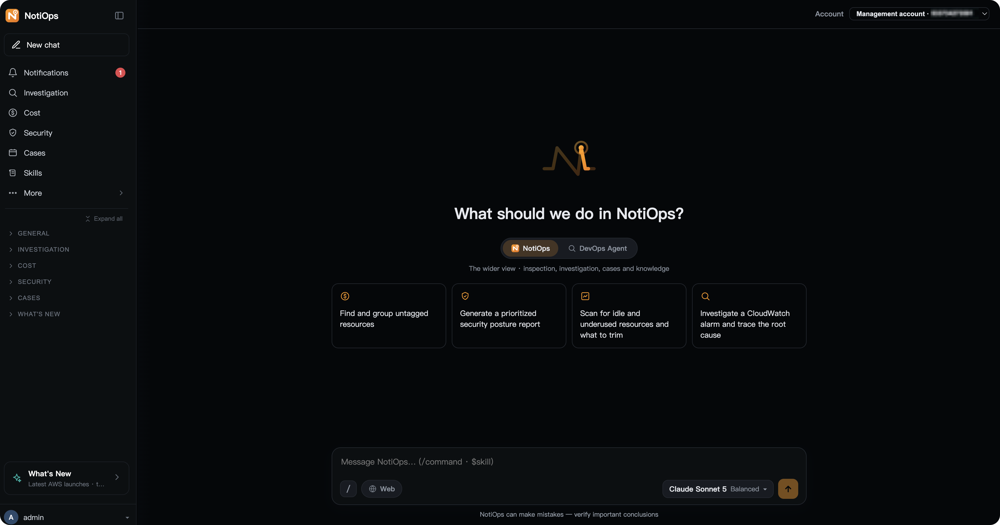

# NotiOps

> 🌐 **Language**: [English](README.md) · [中文](README.zh.md)

> ⚠️ **Disclaimer**: This is sample code, for non-production usage. You should
> work with your security and legal teams to meet your organizational security,
> regulatory, and compliance requirements before deployment. It is provided for
> educational/reference purposes and is not a production-ready product.



**NotiOps** is AWS sample code for a **read-only cloud operations console** — a
browser-based chat app where an engineer asks about their AWS environment in
plain language and gets back a near real-time, cited answer: incident
investigations with a root-cause narrative, cost/FinOps analysis, resource
health inspection, and full AWS Support case management — all without leaving
the web UI or touching the AWS Console.

The same assistant is also available **inside your team's chat tools (Slack /
Feishu / DingTalk)**: `@mention` the bot in an alert channel to run an
investigation and read the report where the alert already landed. On top of
on-demand questions, it **proactively pushes** events from 10 AWS signal sources
(CloudWatch, AWS Health, Backup, GuardDuty, Cost Anomaly, Trusted Advisor, EC2
Spot interruption, Auto Scaling launch failure, RDS, Config) into the Web Chat
**Notifications** inbox, each source independently switchable.

All models are served through **Amazon Bedrock** (managed security, compliance,
and cost controls), with per-session model switching and automatic
English/Chinese localization. The **zero-change promise** rests on IAM as its hard
boundary: the roles both entry points use to reach your account are read-only on
your infrastructure, so a call that changes a resource has no permission. Apart from
the resources NotiOps owns (its tables, buckets and the like), the only write they
carry is AWS Support case create / reply / resolve, and it runs only after you
confirm a preview (a member account's role can be made strictly read-only with the
template parameter `EnableSupportCaseWrite=false`). Defense in depth is layered on top,
differently per entry point: on the web, tool-level read-only enforcement plus a
command-level denylist (for actions that are technically reads but shouldn't be,
such as `get-secret-value`) plus a strictly read-only system prompt; on IM, a
direct call to the read-only AWS DevOps Agent with a strong-mutation-wording
regex as a second gate on the NotiOps side. The assistant reads and reasons, but
never mutates your cloud — safe to hand to on-call engineers without granting them
write access to your infrastructure.

---

## Quick links

| Doc | Purpose |
|---|---|
| 📝 [AWS Blog (English)](https://aws.amazon.com/cn/blogs/china/using-agentic-ai-assistant-notiops-build-aws-operations-en/) | Introductory article: why NotiOps exists, how it is used, architecture and the read-only boundary |
| 🚀 [One-click Deploy](docs/DEPLOYMENT_ONECLICK.en.md) | Browser only: upload one CloudFormation template, about 5 minutes to a running Web Chat (optionally plus one IM bot — Feishu/Lark, Slack or DingTalk) |
| ✅ [Prerequisites](docs/PREREQUISITES.en.md) | **Read before running `./setup.sh`**: environment requirements, per-item fixes, and a one-command self-check (not needed for the one-click path) |
| 🛠 [Deployment Guide](docs/DEPLOYMENT.en.md) | Full install: step-by-step from `./setup.sh` to first smoke test (web console + optional IM) |
| 👤 [User Guide](docs/USER_GUIDE.en.md) | End-user manual + conversation samples + FAQ |
| 🏗 [Technical Design](docs/TECHNICAL_DESIGN.en.md) | Module boundaries / data flow / security / read-only defense in depth |
| 🧑‍💻 [CONTRIBUTING](CONTRIBUTING.md) | Conventions (i18n / security / PR process) |

---

## Features

- 🖥️ **Web console (read-only)**: a browser chat app for incident investigation,
  cost/FinOps analysis, resource-health inspection, and AWS Support case
  management — plain-language in, cited answers out
- 🔍 **Ad-hoc investigation**: ask a single sentence, get a complete report
  (markdown summary + HTML + trace) — typically ~1-3 minutes in internal testing
  (varies with query complexity, account size, and model)
- 🤝 **Two answerers**: a general chat opens with a **conversation-object** picker — the
  NotiOps agent (the wider view: inspection, investigation, cases, knowledge) or **the AWS
  DevOps Agent in your own account answering directly** (on the ground: live diagnostics).
  Pick the latter and it costs **0 NotiOps tokens** and needs **no model setup** (nothing to
  enable in Bedrock), with the same streaming experience as the DevOps Agent's own console.
  The Investigate topic also offers **deep investigation (Direct)**: the same deep
  investigation calling the API without an LLM, also token-free (trade-off: your wording is
  passed through as-is, with no smart rewrite)
- 🛎️ **Proactive observation**: 10 EventBridge sources (CloudWatch / Health /
  Cost Anomaly / Trusted Advisor / GuardDuty / Backup / EC2 Spot interruption /
  Auto Scaling launch failure / RDS / Config) feed the Web Chat **Notifications**
  inbox, each independently switchable — five are on by default
- 📋 **Full AWS Support case management**: create / list / view / reply /
  **smart-analyze** (LLM rollup of the case thread) / resolve
- 💬 **AWS concept Q&A**: Bedrock + Knowledge MCP for official-doc retrieval,
  answers carry 📚 source citations
- 🤖 **Multi-LLM switching**: an operator-managed model catalogue — pick which
  models your deployment offers, set the default, and choose the models used by
  backend tasks, all under **More → Admin → Models** with no redeploy. Users keep a
  per-session model preference. Every model is served through **Amazon Bedrock**
  (managed security, compliance, and cost controls), on either IAM or a Bedrock
  API key
- 🌍 **Bilingual**: Chinese / English auto-detect + explicit switching
- 🛡 **Zero-Change Promise**: IAM as the hard boundary (read-only on your
  infrastructure; apart from NotiOps's own resources, the only write is Support case
  create / reply / resolve, run only after you confirm a preview), then
  defense in depth per entry point — web: tool-level read-only + command
  denylist + read-only system prompt; IM: the read-only DevOps Agent + a
  mutation-wording regex second gate — the assistant never mutates your cloud
- 💬 **IM channels**: Slack / Feishu / DingTalk full-feature — you get a reply **immediately**
  after you ask: on Feishu / Slack progress / thinking / the answer all refresh **in that same
  card** (the seconds in its title are the "still running" signal); DingTalk cannot edit a sent
  message, so the same progress is **appended** as new messages; when a deep investigation
  finishes, its report card is posted back to the conversation that started it.
  **Two agents to pick from**: `/agent devops` is the default (straight to the DevOps Agent,
  0 tokens on the NotiOps side),
  `/agent notiops` switches to the model-backed path (with a `/web on` web-search toggle).
  Every card's footer states three things in one line: **which path the turn took, which model
  answered, and which AWS account the answer is about** — that last segment matters most in a
  multi-account deployment, since `/account` is per-conversation: one person switches and
  everyone in that group follows.

---

## Getting started

Two ways to deploy — pick one.

### Option A: one-click deploy — a browser is all you need

For environments where long-lived access keys aren't available, or where you
can't install the CDK locally: everything happens in the AWS Console, nothing is
installed on your machine.

1. Download `notiops-webchat.template.json` from
   [Releases](https://github.com/aws-samples/sample-notiops/releases/latest);
2. Open the CloudFormation console → **Create stack** → **Upload a template file**;
3. Enter an administrator email (the temporary password is mailed there), tick
   the IAM capabilities acknowledgement, and create — measured at about 5 minutes.
   The stack outputs include the Web Chat URL.

Three optional parameters are worth knowing about:

- **What to install** (`InstallOption`, default `web`) — a four-way dropdown: `web` /
  `web+feishu` / `web+slack` / `web+dingtalk`. **All four install Web Chat**; the latter three add **one** IM
  bot (@-mention it in a group, or DM it — after deploying you still enter its credentials under
  Web Chat **More → Admin → IM Integration** first (saving writes them to Secrets Manager), and
  then fill in a request URL on the IM platform). You can update the stack to a different value
  later.
- **Deep investigation** (AWS DevOps Agent — on by default, free while idle, and silently
  skipped instead of failing the stack in Regions that don't have it).
- **Deployment mode** (single account by default; pick multi-account and supply your
  organization id to run read-only investigations across other accounts in the organization —
  the deploying account must be either the **AWS Organizations management account** or a member
  account registered as a **CloudFormation StackSets delegated administrator** (auto-detected,
  nothing extra to fill in), see
  [docs/DEPLOYMENT_ONECLICK.en.md §2.6.1](docs/DEPLOYMENT_ONECLICK.en.md#261-hard-prerequisite-management-account-or-a-stacksets-delegated-administrator).
  If neither holds, the stack fails within the first minute and the failure reason hands you the
  register command and the management account id).

⚠️ One-click deploys **Web Chat plus at most one IM bot**. It does **not** include scheduled
inspections, proactive push into IM groups (on Option B only Feishu receives it — see the feature
comparison below), or the inspection dashboard (along with its scope and threshold settings; the
sidebar shows no such entry), and one stack can only carry one IM platform — use Option B for those. (CUR/Athena billing detail is on both paths: on one-click it is opt-in, choose `ProvisionCur=yes` when you create the stack.) Prerequisites (region and Bedrock model access), a parameter-by-parameter
walkthrough, the resource and cost breakdown, upgrade/rollback, and one-click teardown are in
[docs/DEPLOYMENT_ONECLICK.en.md](docs/DEPLOYMENT_ONECLICK.en.md); the two IM setup steps are in
[docs/IM_WEBHOOK_SETUP.en.md](docs/IM_WEBHOOK_SETUP.en.md).

### Option B: `setup.sh` — the full install

```bash
# 1. Clone
git clone https://github.com/aws-samples/sample-notiops.git
cd sample-notiops

# 2. Environment self-check (read-only, installs nothing; strongly recommended)
bash scripts/preflight.sh

# 3. Deploy (CDK, one command; interactive on first run)
./setup.sh
# First run: confirm AWS account → pick region → pick IM platforms
# (Slack / Feishu / DingTalk, multi-select) → dependency Layer build (pip, no
# container) → CDK bootstrap → synth → cdk deploy --all. Re-runs only patch
# deltas.
# IM credential secrets are created empty; if you enabled IM, fill them in after
# the deploy under Web Chat More → Admin → IM Integration (saving writes them to
# Secrets Manager), as the completion banner says.
```

Requires git, Node.js, Python, uv and the AWS CDK locally, plus credentials that
can deploy — **no container runtime needed**.

> ⚠️ The version floors are real requirements (Python ≥ 3.10, Node ≥ 22, AWS CLI v2 ≥ 2.13), but
> `setup.sh` only checks whether a command exists — it **never compares versions**; and it does not
> check boto3 at all, whose absence makes the deploy "succeed" with features quietly missing. So run
> `bash scripts/preflight.sh` first — it really does compare versions and prints a fix per item.
> Full list, the consequence of each miss, and how to fix it:
> **[docs/PREREQUISITES.en.md](docs/PREREQUISITES.en.md)**.
> (None of this applies to Option A, the one-click path.)

#### Deploy modes: single-account (default) vs multi-account

Decide before you run `setup.sh` — the mode is baked in at deploy time and
switching later requires a redeploy.

- **Single-account (default)** — `./setup.sh`. NotiOps operates in the deploy
  account only. Least privilege, fastest path to a working install; right for
  most trials and single-account users.
- **Multi-account** — `./setup.sh --multi-account`. Adds cross-member-account
  inspection / investigation / event forwarding across an AWS Organization.
  Member-account resources are rolled out automatically via StackSets.
  **Either deploying identity works**: the organization management account (payer),
  or a member account registered as a **CloudFormation StackSets delegated
  administrator** — the script auto-detects it, there is no flag to pass, and if the
  account does not qualify it prints the `aws organizations
  register-delegated-administrator` command for the management account to run.
  Check first: `aws organizations describe-organization --query
  'Organization.MasterAccountId' --output text` equals `aws sts
  get-caller-identity --query Account --output text` ⇒ this is the management
  account. If they differ, check `aws organizations list-delegated-administrators
  --service-principal member.org.stacksets.cloudformation.amazonaws.com --query
  'DelegatedAdministrators[].Id' --output text` (**`--service-principal` is
  required** — without it you also get other services' delegated administrators,
  which cannot operate StackSets).
  ⚠️ A delegated administrator has **full deployment permissions across the whole
  organization and cannot be scoped to specific OUs**; an organization allows at
  most 5.

For the full deployment walkthrough into your own AWS account — including the
mode comparison and how to switch — see
[docs/DEPLOYMENT.en.md](docs/DEPLOYMENT.en.md).

### Feature comparison

| Capability | Option A (one-click) | Option B (`setup.sh`) |
|---|:---:|:---:|
| **Prerequisites and timing** | | |
| Installed locally | nothing (browser only) | git / Node / Python / **uv** / CDK (**no container runtime**) |
| Long-lived access key required | no | yes, credentials that can deploy |
| Deploy time | about 5 minutes | 10–20 minutes (includes local builds) |
| One-click teardown | ✅ stack parameter `TeardownMode`: `KeepData` / `DeleteEverything` (set it with an update **before** you delete — see below) | ✅ `./teardown.sh` (keeps data by default, `--delete-everything` for a full wipe) |
| **Chat and investigation** | | |
| Web Chat (read-only Q&A) | ✅ | ✅ |
| AWS concept Q&A (official-doc retrieval + citations) | ✅ | ✅ |
| Resource-health inspection (on demand) | ✅ | ✅ |
| Incident investigation (instant, read-only tools) | ✅ | ✅ |
| DevOps Agent deep investigation | ✅ see note ¹ | ✅ |
| Deep investigation (Direct — token-free) | ✅ see note ¹ | ✅ |
| DevOps Chat (your own DevOps Agent answers a general chat directly) | ✅ see note ¹ | ✅ |
| Web search (AgentCore Web Search) | ✅ see note ² | ✅ see note ² |
| Session memory (keeps context within one conversation) | ✅ see note ³ | ✅ see note ³ |
| Cross-session memory (carries preferences and facts into the next conversation) | ❌ see note ³ | ❌ see note ³ |
| **Cost / FinOps** | | |
| FinOps dashboard (Cost Explorer data) | ✅ deploy account only | ✅ cross-account |
| CUR + Athena billing-detail drill-down | ✅ optional (parameter `ProvisionCur=yes`, off by default) | ✅ |
| Daily cost-anomaly scan (self-built baseline, runs 01:15 UTC every day) | ❌ the "Daily Anomaly Scan" card on the FinOps page is not rendered at all — you do not get an empty card | ✅ |
| Bring your own CUR data source (4 dashboard sheets + ask about that bill in chat) | ✅ optional, see note ⁵ | ✅ optional, see note ⁵ |
| **Cases and Skills** | | |
| Full AWS Support case management (multi-account: pick the target account right on the case form) | ✅ | ✅ |
| 11 bundled Skills + your own | ✅ | ✅ |
| Publish a Skill to DevOps Agent | ✅ see note ¹ | ✅ |
| **Models** | | |
| Multi-LLM switching + model catalogue | ✅ | ✅ |
| Bedrock API key as the credential | ✅ | ✅ |
| **Proactive / IM** | | |
| IM channels (Slack / Feishu / DingTalk) | ✅ one platform per stack, see note ⁴ | ✅ all three at once |
| Two agents in IM (`/agent devops`, the 0-token default \| `/agent notiops`, model-backed) + the `/web` toggle | ✅ | ✅ |
| Pick which account you ask about, from IM (`/account`) | ✅ | ✅ |
| Proactive push **to IM** | ❌ | ⚠️ Feishu only: the daily operations notification (inspection + the daily cost-anomaly scan + the last 24h of investigations) and AWS Health events, sent to the "Target group chat IDs" you enter under **More → Admin → IM Integration** (platform "Feishu / Lark"). Real-time pushes for CloudWatch alarms / Backup / GuardDuty / Cost Anomaly Detection / Trusted Advisor reach **no IM on either path** in this release (see them under Notifications on the web); Slack / DingTalk get no proactive push |
| Scheduled inspection (high load / idle & cost / structural risk) | ❌ | ✅ |
| Notification inbox (10 EventBridge sources, into the web inbox) | ✅ | ✅ |
| Inspection dashboard (high load / idle & cost / inspection scope / thresholds & schedule) | ❌ Option A has no inspection backend, so the sidebar entry **does not appear at all** (rather than failing once you open it); calling `/inspection/*` directly returns an explicit `inspection_not_deployed` code (this deployment does not include inspection) | ✅ |
| **Scope** | | |
| Multi-account (across an AWS Organization) — both paths accept the **management account** or a registered **StackSets delegated administrator** member account (auto-detected); ⚠️ CloudFormation never rolls a StackSet into the management account itself: when you deploy from a delegated administrator, query the management account through **"Manual onboarding" alone**, under Web Chat **More → Admin → Accounts** (that stack creates the collection role too; on Option A, first upload `infra/member-devops-agent.yaml` from the stack's release (see the `InstalledRelease` stack output) to `s3://notiops-data-<account>-<region>/onboarding-templates/`, otherwise "Generate link" fails with `template not found` — see [docs/DEPLOYMENT_ONECLICK.en.md §2.6.1](docs/DEPLOYMENT_ONECLICK.en.md#261-hard-prerequisite-management-account-or-a-stacksets-delegated-administrator)), and do **not** also deploy `infra/member-account-onboarding.yaml` by hand — both stacks create a role with the same name, so the second one fails with `EntityAlreadyExists` and rolls back; if it is already deployed, set `CreateCollectionRole` to `no` on the quick-create page (and if that stack forwards events, clear `DevOpsEventBusArn` too, or every investigation event is delivered twice). When you deploy from the management account itself there is nothing to do — it is the deploy account | ✅ set `DeployMode=MultiAccount` + your organization id | ✅ `--multi-account` |
| Upgrade | update the stack with the new template (~1 min) | re-run `./setup.sh` |

> ¹ **Every DevOps Agent capability (deep investigation, deep investigation Direct, DevOps
> Chat, and "publish a Skill to DevOps Agent") shares one Agent Space on Option A.** The
> stack creates it in the deploy account provided that
> `EnableDeepInvestigation=Yes` (the default) **and** the deploy Region is one where
> AWS DevOps Agent is available (`us-east-1`, `us-west-2`, `ca-central-1`, `sa-east-1`,
> `ap-south-1`, `ap-southeast-1`, `ap-southeast-2`, `ap-northeast-1`, `eu-central-1`,
> `eu-west-1`, `eu-west-2`). Other Regions still deploy successfully, just without the
> Agent Space — the related toggles are **greyed out with the reason shown**, and the
> `DeepInvestigationStatus` stack output says whether you turned it off or the Region
> doesn't support it.

> ² **Web search is us-east-1 only, on both paths.** It uses the AWS built-in
> AgentCore Web Search (no third-party API key, and search requests never leave AWS);
> both deployment paths provision that gateway for you, with nothing to configure.
> Deploying elsewhere still succeeds, just without web search — Option A's
> `WebSearchStatus` stack output says why, and Option B's `./setup.sh` says so in the
> deploy log. Note the toggle is **not** greyed out (the UI does no Region check):
> clicking it doesn't error, you just get no results.

> ³ **Memory is per conversation, not across conversations.** Within one conversation it
> remembers what you discussed (AgentCore Memory stores the raw messages per session,
> events expire after 30 days). **A new conversation starts from a clean page** — nothing
> you said in an earlier one is carried over. That is deliberate: less data retained, and
> more predictable behaviour ("why did it answer that?" never traces back to something you
> said days ago and forgot). Anything it should always know belongs in the current
> conversation, or in **explicit** configuration such as a Skill or the system prompt.
>
> Why the within-session layer cannot be dropped: each request carries only your latest
> message, and the model-side session object is rebuilt whenever you switch models, switch
> topics, or the container cold-starts — without it, switching models mid-conversation and
> asking a follow-up would lose all context. The memory resource carries **no retention
> policy**: deleting the stack deletes it and the session messages in it.
> ⚠️ Releases before 2026-09 (v1.0.18 / v1.0.19) did have **cross-session** memory, and its
> actor was one identity shared by the whole deployment (preferences extracted from any
> user were visible to every signed-in user). Upgrading to this release removes that layer;
> already-extracted records are deleted along with the strategies.

> ⁴ **On Option A the IM bot is a dropdown on the parameters page** (`InstallOption`: `web` /
> `web+feishu` / `web+slack` / `web+dingtalk`; the default installs web only). The bot and the web UI share the
> **same read-only backend**, so you can @-mention it in a group or DM it; anything that
> matches "look at resources / start an investigation / check progress / switch model / switch
> language" is deterministic routing and costs **no tokens**. Two differences: (1) one stack
> carries **one** platform (use Option B if you want both); (2) two steps stay with you after
> deploying — enter the credentials under Web Chat **More → Admin → IM Integration** (saving
> writes them to Secrets Manager), then paste the request URL back into the IM platform, in
> that order (the `ImNextSteps` stack output reminds you), as described in
> [docs/IM_WEBHOOK_SETUP.en.md](docs/IM_WEBHOOK_SETUP.en.md). Note this is **request/response
> only**; what gets **pushed** into a group (the daily operations notification and AWS Health
> events, Feishu only) is still Option B only — see the "Proactive push to IM" row above.
>
> ⚠️ **The IM platforms this release supports are Feishu / Lark, Slack and DingTalk**
> (DingTalk since 2026-09-08, on both paths). DingTalk has three **platform-capability**
> differences, which we state outright rather than imply by omission: (1) card buttons can only
> be **links** (so actions that need confirmation — open a case, start an investigation — are
> completed by **replying with a keyword**); (2) a sent message **cannot be edited** (long tasks
> **append** one or two progress messages instead of refreshing a single card, as Feishu does);
> (3) DingTalk **validates nothing** when you save the callback URL (a wrong address raises no
> error on the spot — the only symptom is that the robot never says a word).
> **Microsoft Teams is still unavailable** — `platforms/` ships feishu / slack / dingtalk
> adapters only, no teams, and it remains a known to-do. The platform table is at the top of
> [docs/IM_WEBHOOK_SETUP.en.md](docs/IM_WEBHOOK_SETUP.en.md).

> ⁵ **Bringing your own CUR data source is optional, and identical on both paths.** The
> "CUR + Athena billing-detail drill-down" row above is about **this deploy account's own**
> bill (Option B provisions it; so does Option A with `ProvisionCur=yes`). This row is about
> putting a cost-agent MCP server (45 read-only cost-analysis tools) on top of **one CUR
> table**. Once connected, the FinOps page gains 4 sheets (spend trend / credits / extended
> support / Savings Plans) and you can ask about that bill in chat. There are two ways to
> connect it — **pick one** (filling in both is rejected before anything is deployed):
> - **Self-hosted** (recommended): NotiOps deploys the server for you, from this repository's
>   `cost_mcp/`, into your account (with a dedicated Athena workgroup and a per-query scan
>   cap). On Option A, pick `ProvisionCur=yes` (NotiOps creates the CUR too) or fill in
>   `CurTable` + `CurBucketName` (a CUR you already have); on Option B, run
>   `COST_MCP_SELF_HOST=true ./setup.sh` (by default it uses this account's CUR from the row
>   above, creating it in the same run if there is none yet; to use a different CUR you
>   already have, add `CUR_TABLE=<db>.<table> CUR_BUCKET_NAME=<bucket>`). A table you bring
>   must be in the account and Region you deploy NotiOps to, together with its Glue database
>   and its bucket (that is where the queries run). **A CUR in another account is not
>   supported yet**: a value in `CurRoleArn` (Option A) or `CUR_ROLE_ARN` (Option B) is
>   refused before anything is deployed. Deploy NotiOps in the account that holds the CUR, or
>   use External below.
> - **External** (only for a cost-agent MCP Lambda you already run): Option A takes the
>   parameters `CostAgentMcpUrl` + `CostAgentFunctionArn`; Option B takes the environment
>   variables `COST_AGENT_MCP_URL` + `COST_AGENT_FN_ARN`. **Both values must be supplied
>   together**: a Function URL does not contain the function ARN, and invoke permission can
>   only be granted per resource, so filling in just one gives you a data source that looks
>   installed and 403s on every call — both paths therefore reject a half-configuration
>   **before deploying anything** (on Option A the stack is never created).
>
> **Leave both unset** and the entry points for those 4 sheets simply don't appear; nothing
> else is affected. **If it goes down after you connect it, the tool keeps working**: only
> those 4 sheets say "temporarily unavailable", and chat falls back to Cost Explorer, then to
> the read-only AWS APIs, **telling you it switched data source** (different basis of
> measurement — don't reconcile the numbers blindly). What each option needs from you is in
> [docs/DEPLOYMENT.en.md §14](docs/DEPLOYMENT.en.md#14-customer-cur-dashboard--cost-agent-mcp-optional).

> 📋 **The AWS Support features (create / view / reply / resolve) require the
> account to be on a Business, Enterprise On-Ramp, or Enterprise support plan** —
> that is a requirement of the AWS Support API itself, independent of which
> deployment path you choose. On Basic / Developer the service list comes back empty.

**The two paths compose**: start with Option A to try it out, then run Option B when
you want scheduled inspections and, on Feishu, the daily operations notification. In the
same account and Region, though, the two paths use the same table and bucket names and
cannot exist side by side: first delete the Option A stack with `DeleteEverything` (its
data does not carry over; see "Delete the environment" below), or install Option B in
another Region.

### Upgrading to a new version / deleting the environment

The two options upgrade and uninstall **differently** — follow the one you actually used.

#### Option A (one-click)

**Upgrade to a new version** (measured at about 1 minute):

1. Download the new `notiops-webchat.template.json` from
   [Releases](https://github.com/aws-samples/sample-notiops/releases).
2. CloudFormation console → select your stack → **Update** → **Replace existing
   template** → upload the template you just downloaded.
3. Change **nothing** on the parameters page — pick **Use existing value** for
   everything, click through, then **Submit**.

⚠️ If your stack is on v1.0.20–v1.0.29, has an IM bot and uses the default GitHub artifact
source: **before you Submit**, read the 🔴 note in
[docs/DEPLOYMENT_ONECLICK.en.md §5](docs/DEPLOYMENT_ONECLICK.en.md#5-upgrading), and pick
**Preserve successfully provisioned resources** under **Stack failure options** — `im-code.zip`
has been withdrawn from those releases, so if the upgrade fails, the automatic rollback stops in
`UPDATE_ROLLBACK_FAILED`.

Multi-account mode: before v1.0.30, **Step 2: DevOps Agent** → **Associate** under **More → Admin →
Accounts** could roll a member account's stack back with `EntityAlreadyExists`. After the upgrade,
click **Associate** again for those accounts — every upgrade re-applies both member-account StackSets
(see [docs/DEPLOYMENT_ONECLICK.en.md §5](docs/DEPLOYMENT_ONECLICK.en.md#5-upgrading)).

An upgrade does **not**: resend the invitation email, change the admin email or
password, revert settings you changed under **More → Admin**, or wipe chat history. To roll back,
run the same update again with the **older** template — except that a stack with IM
cannot roll back to v1.0.20–v1.0.29 (same reason: rolling back downloads that version's
`im-code.zip` again, and it has been withdrawn).

**Delete the environment** — the stack has a `TeardownMode` parameter with two settings:

| | What survives |
|---|---|
| `KeepData` (default) | The config table, the chat-history table, and the data bucket (your Skills and reports); if you installed IM or saved a Bedrock API key under **More → Admin → Models**, those credential secrets too |
| `DeleteEverything` | Everything else goes (**including those credential secrets, unrecoverably**), with two exceptions: the CUR resources created by `ProvisionCur=yes`, and the two member-account StackSets of multi-account mode — see below |

⚠️ **Two things to know:**

1. **For a clean delete, the order matters.** First run an **Update** that sets
   `TeardownMode` to `DeleteEverything` (~45 s), **then** **Delete stack** (measured at
   ~6 min 47 s, longer than a `KeepData` delete; see
   [docs/DEPLOYMENT_ONECLICK.en.md §6.3](docs/DEPLOYMENT_ONECLICK.en.md#63-delete)).
   Changing the parameter in the delete dialog does **nothing**: CloudFormation uses the
   parameter values from the last successful deployment, so a straight delete behaves
   as `KeepData`.
2. **Both modes delete the Cognito user pool.** `KeepData` preserves your *data*, not
   your *accounts* — after reinstalling you have to invite users again.

Things that may be left behind afterwards (only small storage charges; delete them by hand
if you want a clean account): the two DynamoDB tables and the data bucket that `KeepData`
preserved; one log group named like
`/aws/vendedlogs/RUMService_notiops-web-chat<hash>` (0 bytes, expires on its own after
30 days; the name is fixed and does not depend on the stack name); and, occasionally, one
function's log group — if that function is invoked in the last seconds of the delete, late
log lines can re-create it (delete it by its full name; see
[docs/DEPLOYMENT_ONECLICK.en.md §6.4](docs/DEPLOYMENT_ONECLICK.en.md#64-whats-left-behind-orphans-and-whether-to-care)).

If you chose `ProvisionCur=yes` when creating the stack, one more group is **kept on
purpose**, in both modes: the CUR report, its delivery bucket, the Athena integration
stack (`notiops-cur-athena-<account>`), and a few Athena saved queries whose names start
with `NotiOps - `. That is your billing history (AWS does not backfill
past months), and keeping it lets a reinstall pick it up at the next 4-hourly check
(within about 4 hours) instead of waiting another ~24 hours for the first delivery. The
report keeps delivering into that bucket, so there is a small S3 storage cost. If you
don't want it, delete it yourself in this order:
the `notiops-cur-athena-<account>` stack first, then the report in the Billing console, and
finally empty and delete the bucket (the saved queries cost nothing; delete them in the
Athena console). The `DataRetentionOnDelete` stack output names all four.

If you chose multi-account mode (`DeployMode=MultiAccount`), the two member-account
StackSets (`notiops-member-onboarding` / `notiops-member-devops-agent`, which created the
cross-account roles in each member account) and the Organizations trusted access for
StackSets are also **left in place on purpose**, in both modes: deleting a StackSet wipes
those roles from every member account, which a stack delete should not trigger implicitly,
and trusted access is an organization-wide switch that other StackSets may rely on. If you
don't want them, delete the StackSet's instances first and then the StackSet itself (in multi-account
mode the `DataRetentionOnDelete` output names these too); see
[docs/DEPLOYMENT_ONECLICK.en.md §6.4](docs/DEPLOYMENT_ONECLICK.en.md#64-whats-left-behind-orphans-and-whether-to-care).

#### Option B (`setup.sh`)

- **Upgrade**: `git pull`, then **re-run `./setup.sh`** — it is incremental and only
  updates what changed. IM credentials you already put in Secrets Manager are not
  overwritten.
  ⚠️ The re-run asks about IM platforms again and shows **which ones are currently
  deployed** — just press Enter to keep them as they are. Only while those platforms stay
  selected does the re-run upgrade the web side **and** the IM side. If you answer `0`
  (skip IM) instead, the script spells out the consequences and asks a separate `[y/N]`
  confirmation that **defaults to keeping** them. Only if you confirm with `y` does this
  deployment **stop managing** the IM you already have: it is **not deleted**, it stays in
  your account serving the **pre-upgrade code**, and from there on the deployment reports
  success from start to finish with no further sign. Non-interactively it keeps them
  unless `IM_PLATFORM_CHOICE` says otherwise explicitly.
  Actually removing IM is a separate, deliberate step — run `./teardown.sh`.
- **Delete**: run **`./teardown.sh`** from the repository root. It deletes what
  `setup.sh` created in reverse dependency order, including the non-CDK leftovers
  (the one-shot EventBridge schedule, the WebSearch gateway, and the 30-day
  recovery window on the secrets; the CUR report, its delivery bucket and the Athena
  integration stack are all kept, see below). Same two settings as Option A:

  ```bash
  ./teardown.sh --dry-run           # inventory only, deletes nothing (run this first)
  ./teardown.sh                     # keep data: delete the stacks, keep the four RETAIN'd tables
  ./teardown.sh --delete-everything  # also delete the tables and leftover log groups. NOTE: everything CUR-related is KEPT
  ```

  You have to type the 12-digit account id to confirm (`--delete-everything` also asks
  you to type `DELETE EVERYTHING`).
  ⚠️ On this path the data bucket `notiops-data-<account>-<region>` is destroyed with
  the stack (your Skills and saved reports live there), so the script **syncs it to a
  local backup directory first** — pass `--no-backup` to skip that.
  If you have deployed **both** options into the same account and Region: they use the
  same resource names, so before emptying a bucket or deleting a table the script asks
  CloudFormation which stack owns it and **skips anything owned by the one-click stack**
  (delete that stack instead).
  Cross-account resources are **deliberately left alone**; the script prints the exact
  commands instead: the two member-account StackSets (deleted only with
  `--delete-member-stacksets`) and the PHD forwarder stack in each linked account
  (`./setup.sh --phd --remove`). CDK bootstrap resources (`CDKToolkit` and friends) are
  never touched.

---

## Architecture (high-level)

```
Web console (browser)     Customer IM (Slack / Feishu / DingTalk)
        │                              │
        └──────────────┬───────────────┘
                       ▼
        ┌────────────────────────────────────────┐
        │   NotiOps (this repo)                  │
        │   · intent classification              │
        │   · read-only defense in depth         │
        │   · case management · bilingual i18n   │
        │   · MCP doc retrieval · Bedrock routing│
        │                 │                      │
        │                 ▼                      │
        │   Lambdas (inspection × 4 / notifier / │
        │   cost / cur-finalizer) + report /     │
        │   push / PHD handlers                  │
        └──────┬────────────────────┬────────────┘
               ▼                    ▼
        AWS investigation     EventBridge × 10
        (via STS AssumeRole)  (CloudWatch / Health / Cost Anomaly / TA /
                               GuardDuty / Backup / EC2 Spot / ASG /
                               RDS / Config)
```

Full architecture in
[docs/architecture-diagram.md](docs/architecture-diagram.md).

---

## Contributing

Read [CONTRIBUTING.md](CONTRIBUTING.md) first. Highlights:

- **Every user-visible string must be bilingual** (zh + en) via
  `core/i18n.py`'s `i18n.t(key, locale)` API — CI enforces this
- **Don't bypass the zero-change promise**: the assistant is read-only; refuse
  any mutation request
- **Commit messages follow [Conventional Commits](https://www.conventionalcommits.org/)**

---

## License

This sample code is licensed under the MIT-0 License. See the [LICENSE](LICENSE) file.
