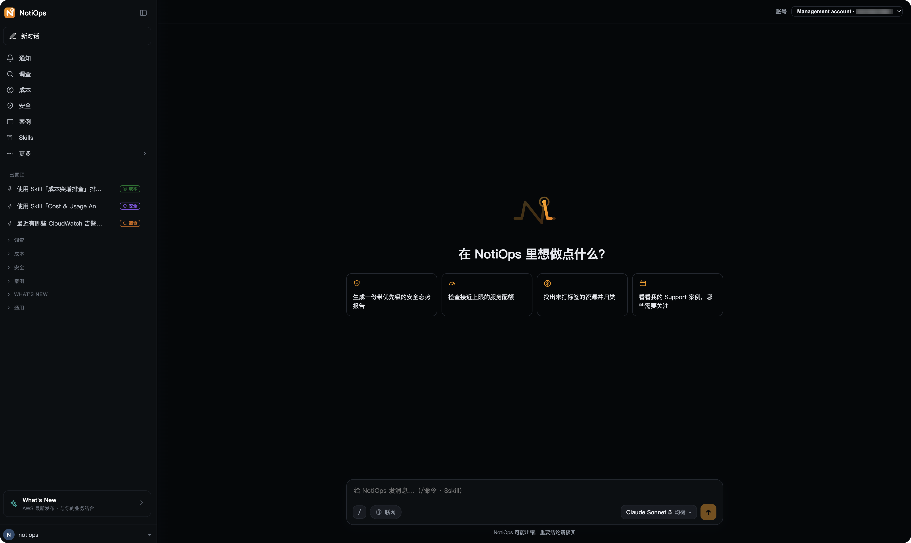

# NotiOps

> 🌐 **语言**: [English](README.md) · [中文](README.zh.md)

> ⚠️ **免责声明**:本项目为示例代码,面向非生产用途。部署前请与你自己的安全、法务
> 团队一起,确保满足你所在组织的安全、监管与合规要求。本项目仅用于教学 / 参考目的,
> 并非生产就绪产品。



**NotiOps** 是一套 AWS 示例代码,提供一个**只读、可追溯的云上 Agentic AI 助手**。主入口是网页版聊天
应用:工程师用大白话询问自己的 AWS 环境,就能拿到近实时、带来源引用的回答:含根因
分析的事件调查、成本 / FinOps 分析、资源健康巡检,以及完整的 AWS Support 工单管理
—— 全程在网页里完成,无需切到 AWS 控制台。

同一个助手也能**接入团队已在用的聊天工具(Slack / 飞书 / 钉钉)**:在告警群里 `@` 机器人
即可发起调查,并直接在告警落地的地方读报告。除了即时提问,它还会把 10 类 AWS 信号源
(CloudWatch、AWS Health、Backup、GuardDuty、成本异常、Trusted Advisor、EC2 Spot 中断预警、
Auto Scaling 启动失败、RDS、Config)的事件**主动推送**到 Web Chat 的「通知」收件箱,每类可独立开关。

默认所有模型都通过 **Amazon Bedrock** 接入(托管的安全、合规与成本管控);管理员也可以
把 OpenAI 兼容网关(LiteLLM、New API 等)排到第一,这时对话发给该网关及其上游供应商。
可按会话切换模型,并自动做中英文本地化。**只读承诺**的硬边界是 **IAM 权限**:两条入口访问你账号用的
角色对你的基础设施只读,改资源的写操作拿不到权限;NotiOps 自己的资源(表、桶等)之外,
它们唯一的写权限是 AWS Support 工单的建 / 回 / 关,而且只在你确认预览之后才执行(成员账号的
角色可用模板参数 `EnableSupportCaseWrite=false` 收成严格只读)。之上再按入口做纵深防御:
网页端是工具层只读 + 命令级 denylist(拦 `get-secret-value` 这类「是只读但不该读」的动作)+ 严格只读的
system prompt;IM 端直连 AWS DevOps Agent 的只读 agent,NotiOps 侧再加一条强变更
措辞正则作二道门。助手只读取、只推理,绝不改动你的云环境 —— 因此可放心交给
on-call 工程师使用,而无需给他们对基础设施的写权限。

---

## 快速链接

| 文档 | 用途 |
|---|---|
| 📝 [AWS 官方博客(中文)](https://aws.amazon.com/cn/blogs/china/using-agentic-ai-assistant-notiops-build-aws-operations/) | 产品介绍文章:为什么做 NotiOps、它怎么用、架构与只读边界 |
| 🚀 [一键部署](docs/DEPLOYMENT_ONECLICK.md) | 只要一个浏览器:上传一份 CloudFormation 模板,大约 5 分钟拿到 Web Chat(可选加装一个 IM 机器人:飞书/Lark、Slack 或钉钉) |
| ✅ [前置条件](docs/PREREQUISITES.md) | **跑 `./setup.sh` 之前先看这页**:环境要求 + 逐项处方 + 一条命令的自检脚本(走一键部署不需要) |
| 🛠 [部署指南](docs/DEPLOYMENT.md) | 完整版:从 `./setup.sh` 到首次冒烟测试的分步指南(Web 控制台 + 可选 IM) |
| 👤 [用户指南](docs/USER_GUIDE.md) | 终端用户手册 + 对话示例 + FAQ |
| 🏗 [技术设计](docs/TECHNICAL_DESIGN.md) | 模块边界 / 数据流 / 安全 / 只读纵深防线 |
| 🧑‍💻 [贡献指南](CONTRIBUTING.md) | 约定(i18n / 安全 / PR 流程) |

---

## 功能

- 🖥️ **网页控制台(只读)**:浏览器聊天应用,支持事件调查、成本 / FinOps 分析、
  资源健康巡检、AWS Support 工单管理 —— 大白话进,带引用的答案出
- 🔍 **即时调查**:一句话提问,拿到完整报告(markdown 摘要 + HTML + trace)——
  内部测试中通常约 1-3 分钟(随问题复杂度、账号规模与模型而变)
- 🤝 **两种"谁来回答"**:通用聊天开头可选**对话对象** —— NotiOps 自己的 agent(全局视角:巡检、
  调查、案例、知识库),或**你自己账号里的 AWS DevOps Agent 直答**(深入现场:实时排查)。
  选后者时 **NotiOps 侧 0 token**、**免模型配置**(不需要在 Bedrock 开通任何模型),流式输出
  体验与 DevOps Agent 自己的页面一致。调查主题另有 **深度调查(直连)**:同一个深度调查绕过
  大模型直连 API,同样不耗 token(代价:调查描述按你的原话透传,不做智能改写)
- 🛎️ **主动观测**:10 类 EventBridge 信号源(CloudWatch / Health / 成本异常 /
  Trusted Advisor / GuardDuty / Backup / EC2 Spot 中断预警 / Auto Scaling 启动失败 /
  RDS / Config)进 Web Chat 的「通知」收件箱,每类可独立开关 —— 其中 5 类默认开启
- 📋 **完整 AWS Support 工单管理**:创建 / 列表 / 查看 / 回复 /
  **智能分析**(对工单会话做 LLM 归纳) / 解决
- 💬 **AWS 概念问答**:Bedrock + Knowledge MCP 检索官方文档,答案带 📚 来源引用
- 🤖 **多模型切换**:由运维方管理的模型目录 —— 在「更多 → 管理 → 模型」里勾选本部署对外提供
  哪些模型、设默认模型、指定后端任务用哪个模型,改完即时生效无需重新部署;用户侧
  仍按会话保存自己的模型偏好。模型来源可以是 **Amazon Bedrock**(托管的安全、
  合规与成本管控;凭证用 IAM 或 Bedrock API Key),也可以是管理员排到第一的
  **OpenAI 兼容网关**(LiteLLM、New API 等)
- 🌍 **双语**:中 / 英自动识别 + 显式切换
- 🛡 **只读承诺**:硬边界是 IAM 权限(对你的基础设施只读;NotiOps 自身资源之外,唯一的写权限是 Support 工单的建 / 回 / 关,确认预览后才执行);之上按入口纵深防御 —— 网页端工具层只读 + 命令级 denylist + 只读 system prompt,IM 端 DevOps Agent 只读 agent + 强变更措辞正则二道门 —— 助手绝不改动你的云
- 💬 **IM 渠道**:Slack / 飞书 / 钉钉 全功能 —— 提问后**立刻**有回应:飞书 / Slack 上过程 / 思考 / 答案都刷在**同一张卡**上(标题里的秒数就是"还在跑"的信号),钉钉改不了已发出的消息,同样的进度是**追加**成新消息发出来;深度调查跑完后报告卡自动回贴到发起它的那个会话。**两个 agent 可选**:默认 `/agent devops`(直连 DevOps Agent,NotiOps 侧 0 token),`/agent notiops` 切到走模型的那条路(带 `/web on` 联网开关)。每张卡最下面一行落款说清这一轮的三件事:**走的哪条路 / 哪个模型答的 / 问的哪个 AWS 账号** —— 多账号部署里最后这一段尤其要紧,`/account` 是按会话生效的,群里任何人切一次后面所有人都跟着换

---

## 快速开始

两种部署方式,选一种即可。

### 方式 A:一键部署 —— 只要一个浏览器

适合拿不到长期 access key,或不允许在本地装 CDK 的环境:全程在 AWS
控制台里完成,你自己的机器上什么都不用装。

1. 从 [Releases](https://github.com/aws-samples/sample-notiops/releases/latest)
   下载 `notiops-webchat.template.json`;
2. 打开 CloudFormation 控制台 → **Create stack** → **Upload a template file**;
3. 填管理员邮箱(临时密码会发到这个邮箱)、勾选 IAM 能力确认框、创建 —— 实测大约
   5 分钟完成,栈输出里就是 Web Chat 的访问地址。

开栈时有三个可选参数值得知道:

- **安装选项**(`InstallOption`,默认 `web`)—— 下拉四选一:`web` / `web+feishu` /
  `web+slack` / `web+dingtalk`。**四个都装 Web Chat**,后三个再加**一个** IM 机器人(群里 @ 它或私聊它;
  部署完还要先在 Web Chat「更多 → 管理 → 集成 IM」里填凭证(保存即写进 Secrets Manager),
  再到 IM 平台侧填一次请求地址)。部署完也能 update 栈换成另一个值。
- **深度调查**(AWS DevOps Agent,默认开,闲置不计费,区域不支持时自动跳过而不是让栈失败)。
- **部署模式**(默认单账号;选多账号并填组织 id,就能跨组织内其它账号做只读排查 ——
  部署身份要么是 **AWS Organizations 管理账号**,要么是一个已注册的 **CloudFormation
  StackSets 委派管理员**成员账号(自动探测,不用多填参数),详见
  [docs/DEPLOYMENT_ONECLICK.md §2.6.1](docs/DEPLOYMENT_ONECLICK.md#261-硬性前置管理账号或-stacksets-委派管理员);
  两种都不是时栈会在第一分钟内失败,并在失败原因里给出注册命令与管理账号号)。

⚠️ 一键部署装的是 **Web Chat + 可选一个 IM 机器人**,**不含**定时巡检、往 IM 群里的主动推送
(方式 B 上也只有飞书收得到,见下面的功能对比)、巡检看板(连同巡检范围与阈值配置,侧栏里不出现
这一项),一个栈也只能装一个 IM 平台 —— 要这些请用下面的方式 B。(CUR/Athena 账单明细两条路径都有:一键部署是可选项,开栈时选 `ProvisionCur=yes`。)
前提条件(区域与 Bedrock 模型开通)、参数逐条说明、资源与成本构成、升级 / 回滚、
一键删除,见 [docs/DEPLOYMENT_ONECLICK.md](docs/DEPLOYMENT_ONECLICK.md);IM 那两步配置见
[docs/IM_WEBHOOK_SETUP.md](docs/IM_WEBHOOK_SETUP.md)。

### 方式 B:`setup.sh` —— 完整版

```bash
# 1. 克隆
git clone https://github.com/aws-samples/sample-notiops.git
cd sample-notiops

# 2. 环境自检(只读,不装任何东西;强烈建议先跑)
bash scripts/preflight.sh

# 3. 部署(CDK,一条命令;首次运行为交互式)
./setup.sh
# 首次运行:确认 AWS 账号 → 选区域 → 选 IM 平台(Slack / 飞书 / 钉钉,可多选)→
# 构建依赖 Layer(pip,无需容器)→ CDK bootstrap → synth → cdk deploy --all。
# 重复运行只增量更新。
# IM 凭据 Secret 创建时为空;启用了 IM 的话,部署完按完成横幅在
# Web Chat「更多 → 管理 → 集成 IM」里填(保存即写进 Secrets Manager)。
```

需要本地有 git / Node.js / Python / uv / AWS CDK,以及一份能部署的 AWS 凭证 —— **不需要容器运行时**。

> ⚠️ 版本下限是真实要求(Python ≥ 3.10、Node ≥ 22、AWS CLI v2 ≥ 2.13),但 `setup.sh` 只检查命令
> 在不在、**不比版本**;boto3 它完全不检查,缺了会让部署"成功"但少装功能。所以请先跑
> `bash scripts/preflight.sh` —— 它会真的比版本,并给出逐项处方。
> 完整清单、每一项不满足的后果与修法:**[docs/PREREQUISITES.md](docs/PREREQUISITES.md)**。
> (走方式 A 一键部署的话,这些一个都不需要。)

#### 部署模式:单账号(默认) vs 多账号

在跑 `setup.sh` 前先定 —— 模式在部署时写死,之后切换需要重新部署。

- **单账号(默认)** —— `./setup.sh`。NotiOps 只在部署账号内运行。最小权限、
  最快跑通,适合绝大多数试用与单账号用户。
- **多账号** —— `./setup.sh --multi-account`。在 AWS Organizations 内增加跨成员账号的巡检 /
  调查 / 事件转发,成员账号资源经 StackSets 自动下发。

  **部署身份(二选一,脚本自动探测,不用加开关):**

  - 组织管理账号(payer);
  - 或一个已注册成 **CloudFormation StackSets 委派管理员**的成员账号 —— 怎么注册见 AWS 官方文档
    [Register a delegated administrator member account](https://docs.aws.amazon.com/AWSCloudFormation/latest/UserGuide/stacksets-orgs-delegated-admin.html)。身份不合格时,脚本会把管理账号要跑的那条
    `aws organizations register-delegated-administrator` 原样打出来。

  **跑之前先自查:**

  1. 下面两条输出相同 ⇒ 当前是管理账号:

     ```bash
     aws organizations describe-organization --query 'Organization.MasterAccountId' --output text
     aws sts get-caller-identity --query Account --output text
     ```

  2. 不相同 ⇒ 再查当前账号在不在 StackSets 委派管理员名单里:

     ```bash
     aws organizations list-delegated-administrators \
       --service-principal member.org.stacksets.cloudformation.amazonaws.com \
       --query 'DelegatedAdministrators[].Id' --output text
     ```

     **必须带 `--service-principal`**:不带会列出别的服务的委派管理员,那些账号操作不了 StackSet。

  > ⚠️ 委派管理员**对全组织有完整部署权限,管理账号无法把它收窄到某个 OU**;一个组织最多同时注册
  > 5 个 StackSets 委派管理员(都见上面的官方文档)。

完整的部署到你自己 AWS 账号的步骤(含模式对比与如何切换)见
[docs/DEPLOYMENT.md](docs/DEPLOYMENT.md)。

### 两种方式的功能对比

| 能力 | 方式 A(一键部署) | 方式 B(`setup.sh`) |
|---|:---:|:---:|
| **前提与耗时** | | |
| 本地要装的东西 | 无(只要浏览器) | git / Node / Python / **uv** / CDK(**不需要容器运行时**) |
| 需要长期 access key | 不需要 | 需要一份能部署的凭证 |
| 部署耗时 | 大约 5 分钟 | 十几分钟(含本地构建) |
| 一键删除整个环境 | ✅ 栈参数 `TeardownMode`:`KeepData` / `DeleteEverything`(要在删栈**之前**先 update 设好,见下文) | ✅ `./teardown.sh`(默认保数据 / `--delete-everything` 全删) |
| **聊天与调查** | | |
| 网页 Web Chat(只读问答) | ✅ | ✅ |
| AWS 概念问答(官方文档检索 + 引用) | ✅ | ✅ |
| 资源健康巡检(按需提问) | ✅ | ✅ |
| 故障调查(即时,只读工具) | ✅ | ✅ |
| DevOps Agent 深度调查 | ✅ 见下方注 ¹ | ✅ |
| 深度调查(直连,不耗 token) | ✅ 见下方注 ¹ | ✅ |
| DevOps 对话(通用聊天里让你自己的 DevOps Agent 直答) | ✅ 见下方注 ¹ | ✅ |
| 联网搜索(AgentCore Web Search) | ✅ 见下方注 ² | ✅ 见下方注 ² |
| 会话记忆(同一会话内接得上上文) | ✅ 见下方注 ³ | ✅ 见下方注 ³ |
| 跨会话记忆(把偏好与事实带到下一个会话) | ❌ 见下方注 ³ | ❌ 见下方注 ³ |
| **成本 / FinOps** | | |
| FinOps 仪表盘(Cost Explorer 口径) | ✅ 仅部署账号 | ✅ 可跨账号 |
| CUR + Athena 账单明细下钻 | ✅ 可选(参数 `ProvisionCur=yes`,默认关) | ✅ |
| 每日成本异常扫描(自建基线,每天 01:15 UTC 跑) | ❌ FinOps 页那张「每日异常扫描」卡整个不出现,不是一张空卡 | ✅ |
| 接自己的 CUR 数据源(4 个仪表盘 sheet + 聊天里问那份账单) | ✅ 可选,默认关(开栈时选 `ProvisionCur=yes` 或填 `CurTable`),见下方注 ⁵ | ✅ 可选,默认关(要显式开:`COST_MCP_SELF_HOST=true ./setup.sh`),见下方注 ⁵ |
| **工单与 Skills** | | |
| AWS Support 工单全生命周期(多账号:开案例卡上直接选开到哪个账号) | ✅ | ✅ |
| 12 个预置 Skill + 客户自建 | ✅ | ✅ |
| 把 Skill 发布到 DevOps Agent | ✅ 见下方注 ¹ | ✅ |
| **模型** | | |
| 多模型切换 + 模型目录管理 | ✅ | ✅ |
| 用 Bedrock API Key 作为凭证 | ✅ | ✅ |
| 用 OpenAI 兼容网关作模型来源 | ✅ | ✅ |
| **主动化 / IM** | | |
| IM 渠道(Slack / 飞书 / 钉钉) | ✅ 一个栈一个平台,见下方注 ⁴ | ✅ 三个可同时开 |
| IM 里两个 agent 可选(`/agent devops` 默认 0 token \| `/agent notiops` 走模型)+ `/web` 联网开关 | ✅ | ✅ |
| IM 里换「问哪个账号」(`/account`) | ✅ | ✅ |
| 主动推送**到 IM** | ❌ | ⚠️ 只有飞书:每日运维通知(资源巡检 + 每日成本异常扫描 + 过去 24h 的调查)与 AWS Health 事件,发到「更多 → 管理 → 集成 IM」(平台选「飞书 / Lark」)里填的「推送群组 Chat ID」。CloudWatch 告警 / Backup / GuardDuty / Cost Anomaly Detection / Trusted Advisor 的实时推送本版本**哪条路径都不进 IM**(在 Web「通知」里看);Slack / 钉钉收不到主动推送 |
| 定时自动巡检(高负载 / 闲置与成本 / 结构性风险) | ❌ | ✅ |
| 通知收件箱(10 类 EventBridge 信号源,进 Web 收件箱) | ✅ | ✅ |
| 巡检看板(高负载 / 闲置与成本 / 巡检范围 / 阈值与定时) | ❌ 方式 A 没有巡检后端,所以侧栏里**根本不出现**这个入口(不是"点进去报错");直接调 `/inspection/*` 接口拿到的是明确的 `inspection_not_deployed`(这套部署不含巡检) | ✅ |
| **范围** | | |
| 多账号(AWS Organizations 跨账号)—— 两条路径都接受**管理账号**或**已注册的 [StackSets 委派管理员](https://docs.aws.amazon.com/AWSCloudFormation/latest/UserGuide/stacksets-orgs-delegated-admin.html)**成员账号(自动探测);⚠️ CFN 从不把 StackSet 下发到管理账号本身:从委派管理员部署时,要查管理账号**只用** Web Chat「更多 → 管理 → 账户」里的「手动接入账号」(那个栈连采集角色一起建;方式 A 要先把与栈同版本(看栈输出 `InstalledRelease`)的 `infra/member-devops-agent.yaml` 传到 `s3://notiops-data-<账号>-<区域>/onboarding-templates/`,否则「生成链接」报 `template not found`,见 [docs/DEPLOYMENT_ONECLICK.md §2.6.1](docs/DEPLOYMENT_ONECLICK.md#261-硬性前置管理账号或-stacksets-委派管理员)),**别再**手工部 `infra/member-account-onboarding.yaml` —— 两个栈建同名角色,后部的那个 `EntityAlreadyExists`、整栈回滚;已经部过的话,在 quick-create 页把 `CreateCollectionRole` 改成 `no`(那个栈开了事件转发的话,`DevOpsEventBusArn` 也清空,否则每个调查事件投两次)。从管理账号本身部署时什么都不用做,它就是部署账号 | ✅ 开栈时选 `DeployMode=MultiAccount` + 填组织 id | ✅ `--multi-account` |
| 升级 | 换新版模板 update 栈(~1 分钟) | 重跑 `./setup.sh` |

> ¹ **所有 DevOps Agent 相关能力(深度调查、深度调查(直连)、DevOps 对话、把 Skill 发布到
> DevOps Agent)在方式 A 里依赖同一个 Agent Space**:
> 栈会在部署账号里建它,前提是参数 `EnableDeepInvestigation=Yes`(默认值)**且**部署区域
> 在 AWS DevOps Agent 已开服的区域内(`us-east-1` / `us-west-2` / `ca-central-1` /
> `sa-east-1` / `ap-south-1` / `ap-southeast-1` / `ap-southeast-2` / `ap-northeast-1` /
> `eu-central-1` / `eu-west-1` / `eu-west-2`)。别的区域照样开栈成功,只是没有 Agent Space
> —— 界面上相关开关会**置灰并写清原因**,栈输出 `DeepInvestigationStatus` 会说明是你自己
> 关的还是该区域不支持。

> ² **联网搜索只有 `us-east-1`,两条路径都一样。** 用的是 AWS 内建的 AgentCore Web
> Search(不需要任何第三方 API key,搜索请求不出 AWS),两种部署方式都会自动建好那个
> Gateway,你不用配任何东西。部署在别的区域照样成功,只是没有联网搜索 —— 方式 A 的栈
> 输出 `WebSearchStatus` 会写明原因,方式 B 的 `./setup.sh` 会在部署日志里说一句。
> 注意这个开关**不会置灰**(界面不做区域判断),点了不报错,只是搜不到东西。

> ³ **记忆只在会话内,不跨会话。** 同一个会话里它记得前面聊过什么(用 AgentCore Memory
> 按会话存原始消息,事件保留 30 天);**换一个新会话就是干净的一页** —— 你上个会话说过的
> 偏好和事实不会被带过来。这是有意的设计:少一份跨会话的数据留存,行为也更可预期
> (「它为什么突然这么答」不会来自你早就忘了的某句话)。想让它记住的,请在当前会话里说,
> 或者写进 Skill / 系统提示这类**显式**配置里。
>
> 为什么会话内这一层不能省:每一轮请求只带你这一句话,而模型侧的会话对象会因为换模型、
> 换主题、容器冷启动而重建 —— 少了它,你在同一个会话里换个模型再追问一句,上文就没了。
> 记忆资源**没有保留策略**:删栈会把它和里面的会话消息一起删掉。
> ⚠️ 早于 2026-09 的版本(v1.0.18 / v1.0.19)带**跨会话**记忆,而且当时的 actor 是整个部署
> 共用的一个身份(任何用户抽出的偏好所有登录用户都看得到)。升级到本版之后这层就没有了;
> 已经抽取出来的记录会随 strategy 一起删除。

> ⁴ **方式 A 的 IM 是开栈时的一个下拉选项**(`InstallOption`:`web` / `web+feishu` /
> `web+slack` / `web+dingtalk`,默认只装 web)。装出来的机器人和网页用的是**同一个只读后端**,群里 @ 它、
> 或者私聊它就能问;命中「查资源 / 发起调查 / 看进度 / 切模型 / 切语言」这些是确定性路由,
> **不花 token**。两处差别:① 一个栈只能装**一个**平台(两个都要走方式 B);② 部署完还有
> 两步在你手上 —— 在 Web Chat「更多 → 管理 → 集成 IM」填凭证(保存即写进 Secrets Manager)、
> 再把请求地址填回 IM 平台(顺序不能反,栈输出 `ImNextSteps` 会提醒你),步骤见
> [docs/IM_WEBHOOK_SETUP.md](docs/IM_WEBHOOK_SETUP.md)。
> 注意这只是**问答**;往群里**主动推**的那几样(每日运维通知与 AWS Health 事件,只发飞书)
> 仍然只有方式 B 有,见上表「主动推送到 IM」那一行。
>
> ⚠️ **本版本支持的 IM 是飞书 / Lark、Slack、钉钉**(钉钉 2026-09-08 起,两条路径都支持)。
> 钉钉有三处**平台能力**差异,我们写出来而不是靠"没提到"暗示:① 卡片按钮**只能是链接**
> (所以需要确认的操作 —— 开案例、启动调查 —— 在钉钉里**用回复关键词**完成);② 已发出
> 的消息**改不了**(长任务**追加**一两条进度消息,不像飞书那样刷同一张卡);③ 钉钉保存
> 回调地址时**不做任何校验**(地址填错不会当场报错,症状只是机器人一句话不回)。
> **Microsoft Teams 仍然不可用** —— `platforms/` 下只有 feishu / slack / dingtalk 三个适配器,
> 没有 teams,列为 to-do。
> 平台对照表在 [docs/IM_WEBHOOK_SETUP.md](docs/IM_WEBHOOK_SETUP.md) 顶部。

> ⁵ **接自己的 CUR 数据源是可选的,两条路径一样。** 上面那行「CUR + Athena 账单明细下钻」
> 说的是**本部署账号自己的**账单(方式 B 自动建;方式 A 选 `ProvisionCur=yes` 时也会建);这一行说的是
> 在**某一份 CUR 表**上接一个 cost-agent MCP server(45 个只读成本分析工具)。接上之后 FinOps 页多出
> 4 张表(费用趋势 / Credit / 扩展支持 / Savings Plans),聊天里也能直接问那份账单。两种接法,
> **二选一**(两个都填会在部署任何东西之前被拒):
> - **自建**(推荐):NotiOps 用本仓库的 `cost_mcp/` 替你把这个 server 部署在你的账号里(专用 Athena
>   workgroup,单次查询的扫描量有上限)。方式 A 选 `ProvisionCur=yes`(连 CUR 一起建),或者填
>   `CurTable` + `CurBucketName`(用你已有的那份 CUR);方式 B 跑 `COST_MCP_SELF_HOST=true ./setup.sh`
>   (默认用上面那行说的本账号那份 CUR,还没有的话同一次运行里一起建好;要换成你已有的另一份,
>   再带上 `CUR_TABLE=<库>.<表> CUR_BUCKET_NAME=<桶>`)。自己带表时,那张表连同它的 Glue 库和桶
>   都必须在部署 NotiOps 的这个账号、这个区域里(查询就在这里跑)。**CUR 在另一个账号暂不支持**:
>   方式 A 的 `CurRoleArn`、方式 B 的 `CUR_ROLE_ARN` 填了都会在部署任何东西之前被拒。要么把 NotiOps
>   部署在 CUR 所在的账号,要么用下面的外接。
> - **外接**(只用于你自己已经在跑的那个 cost-agent MCP Lambda):方式 A 填参数 `CostAgentMcpUrl` +
>   `CostAgentFunctionArn`,方式 B 传环境变量 `COST_AGENT_MCP_URL` + `COST_AGENT_FN_ARN`。
>   **两个值必须一起给**:Function URL 里不含函数 ARN,而调用授权只能按资源给,只填一半会得到一个
>   "看起来装好了、每次调用 403"的数据源 —— 所以两条路径都会在**部署任何东西之前**拒掉半配置(方式 A 的栈
>   根本不会创建)。
>
> **都不填**:那 4 张表的入口直接不出现,其余功能不受影响。**接上之后它挂掉也不会拖垮工具**:
> 仪表盘只有那 4 张表写「暂时不可用」,聊天会自动退到 Cost Explorer、再退到 AWS 只读 API,并
> **明确告诉你换了数据源**(口径不同,别直接拿去对账)。两种接法各要给哪些值,见
> [docs/DEPLOYMENT.md §14](docs/DEPLOYMENT.md#14-客户-cur-仪表盘--cost-agent-mcp可选)。

> 📋 **AWS Support 相关功能(建案 / 查案 / 回复 / 解决)需要账号开通 Business、
> Enterprise On-Ramp 或 Enterprise 支持计划** —— 这是 AWS Support API 本身的要求,
> 与用哪种部署方式无关。Basic / Developer 计划下服务列表会是空的。

**两条路径可以先后走**:先用方式 A 试用,之后想要自动巡检(以及飞书群里的每日运维通知),
再跑方式 B。但同一账号同一区域里两条路径用的是同一套表 / 桶名,不能同时存在:要先把方式 A 的栈
按 `DeleteEverything` 删掉(数据不会带过去;删法见下面「删除整个环境」),或者把方式 B 装到另一个区域。

### 升级到新版本 / 删除整个环境

两种方式的升级和卸载步骤**不一样**,请照着你实际用的那一种做。

#### 方式 A(一键部署)

**升级到新版本**(实测约 1 分钟):

1. 从 [Releases](https://github.com/aws-samples/sample-notiops/releases) 下新版本的
   `notiops-webchat.template.json`。
2. CloudFormation 控制台 → 选中你的栈 → **Update** → **Replace existing template** →
   上传刚下的模板。
3. 参数页**什么都不用改**,一路选 **Use existing value** → 下一步到底 → **Submit**。

⚠️ 栈现在是 v1.0.20–v1.0.29、装了 IM 机器人、产物走默认的 GitHub 来源的话:**Submit 之前**先读
[docs/DEPLOYMENT_ONECLICK.md §5](docs/DEPLOYMENT_ONECLICK.md#5-升级到新版本) 里 🔴 那一条,并在
**Stack failure options** 里选 **Preserve successfully provisioned resources** —— 这几个版本的
`im-code.zip` 已经撤下,升级万一失败,自动回滚会停在 `UPDATE_ROLLBACK_FAILED`。

多账号模式:v1.0.30 之前,「更多 → 管理 → 账户」里「第二步: DevOps Agent」的「一键关联」可能因
`EntityAlreadyExists` 让成员账号的栈整栈回滚。升级之后对这些账号再点一次「一键关联」即可(每次升级都会把
两个成员账号 StackSet 重新下发一遍,见 [docs/DEPLOYMENT_ONECLICK.md §5](docs/DEPLOYMENT_ONECLICK.md#5-升级到新版本))。

升级**不会**动这些:不重发邀请邮件、管理员邮箱和密码不变、你在「更多 → 管理」里改过的配置不变、
聊天历史不清空。想回退就用**旧版本的模板**再 update 一次 —— 但装了 IM 的栈回退不到
v1.0.20–v1.0.29(原因同上:回退要重新下载那个版本的 `im-code.zip`,而它已经撤下)。

**删除整个环境** —— 栈有一个 `TeardownMode` 参数,两档:

| | 保留什么 |
|---|---|
| `KeepData`(默认) | 保留配置表、聊天记录表、数据桶(里面有你的 Skill 和报告);装过 IM、或在「更多 → 管理 → 模型」存过 Bedrock API Key / 网关的话,这些凭证 secret 也留着 |
| `DeleteEverything` | 其余全删(**含这些凭证 secret,不可恢复**),只有两类除外:选了 `ProvisionCur=yes` 时建的 CUR 相关资源,以及选了多账号模式时的两个成员账号 StackSet,见下 |

⚠️ **两个必须注意的点:**

1. **要删干净,顺序不能错** —— 先做一次 **Update**,把 `TeardownMode` 改成
   `DeleteEverything`(约 45 秒),**然后**再 **Delete stack**(实测约 6 分 47 秒,比按 `KeepData`
   删要久,见 [docs/DEPLOYMENT_ONECLICK.md §6.3](docs/DEPLOYMENT_ONECLICK.md#63-删除))。
   在删除对话框里改这个参数是**没有用的**:CloudFormation 用的是最后一次成功部署时的参数值。
   如果直接删,就是按 `KeepData` 删的。
2. **两种模式都会删掉 Cognito 用户池** —— `KeepData` 保的是**数据**,不是**账号**。
   重新装完之后,用户需要重新邀请。

删完之后可能还剩下(只有很少的存储费用,想清就手工删):`KeepData` 模式保下来的两张 DynamoDB 表和
数据桶;一个名字像 `/aws/vendedlogs/RUMService_notiops-web-chat<随机串>` 的日志组
(0 字节,30 天自动过期;名字是固定的,不跟栈名走);偶尔还有某个函数的日志组 —— 删栈最后几秒
恰好有调用时,晚到的日志会把它重新建出来(按完整名字删掉即可,见
[docs/DEPLOYMENT_ONECLICK.md §6.4](docs/DEPLOYMENT_ONECLICK.md#64-会留下的东西孤儿要不要管))。

开栈时选了 `ProvisionCur=yes` 的话,还有一组是**故意留下**的,两种模式都不删:CUR 报告、
它的交付桶、Athena 集成栈(`notiops-cur-athena-<账号>`),以及 `NotiOps - ` 开头的几条 Athena
保存查询。那是你的账单历史(AWS 不补发过去的月份),留着也能让重装后由下一次每 4 小时一次的
检查接上(约 4 小时内),而不必再等约 24 小时的首次交付。报告会继续往那个桶里交付,所以会有少量
S3 存储费用。不要了就自己删,顺序是:先删 `notiops-cur-athena-<账号>` 栈,再在 Billing 控制台删掉
报告,最后清空并删掉那个桶(保存查询不收费,在 Athena 控制台里删)。栈输出 `DataRetentionOnDelete`
会逐个点名这四样。

选了多账号模式(`DeployMode=MultiAccount`)的话,两个成员账号 StackSet(`notiops-member-onboarding` /
`notiops-member-devops-agent`,各成员账号里的跨账号角色就是它们建的)和 Organizations 对 StackSets 的
信任访问,两种模式也都**故意不删**:删 StackSet 等于抹掉每个成员账号里的这些角色,这种跨账号的动作
不该由「删一个栈」顺手触发;信任访问是组织级开关,组织里别的 StackSet 也可能在用。不要了就先删
StackSet 里的实例、再删 StackSet 本身(多账号模式下 `DataRetentionOnDelete` 也会点名这几样),见
[docs/DEPLOYMENT_ONECLICK.md §6.4](docs/DEPLOYMENT_ONECLICK.md#64-会留下的东西孤儿要不要管)。

#### 方式 B(`setup.sh`)

- **升级**:`git pull` 拉最新代码,**重跑 `./setup.sh`** —— 它是增量的,只更新有变化的部分。
  你之前填进 Secrets Manager 的 IM 凭据不会被覆盖。
  ⚠️ 重跑会再问一次「选 IM 平台」,并显示**当前已经装了哪些平台** —— 直接回车就是保持原样。
  只有这些平台保持选中,这次升级才会**同时**更新 web 端和 IM 端。要是这次选了 `0`(暂不部署 IM),
  本次部署就**不再管**你已经装好的那套 IM:它**不会被删掉**,而是原样留在你账号里继续跑
  **升级前的旧代码**。脚本会把这个后果整块打出来,再单独问一次 `[y/N]`(**默认保留**);
  只有你明确回 `y` 才真的停更,之后部署过程从头到尾报成功、不再有别的信号。非交互环境下
  除非显式设了 `IM_PLATFORM_CHOICE`,否则一律自动保留。真要下掉 IM 是单独一件事,
  走 `./teardown.sh`。
- **删除**:跑仓库根目录的 **`./teardown.sh`**,它按依赖倒序把 `setup.sh` 建的东西删干净
  (含 CDK 之外的收尾:一次性 EventBridge Scheduler、WebSearch Gateway、
  Secrets 的 30 天恢复期;CUR 报告、交付桶与 Athena 集成栈一律保留,见下)。和方式 A 一样是两档语义:

  ```bash
  ./teardown.sh --dry-run          # 先看清单,什么都不删(强烈建议先跑这个)
  ./teardown.sh                    # 保数据:删栈与运行时,保留四张 RETAIN 表
  ./teardown.sh --delete-everything # 全删:连表、残留日志组。⚠️ CUR 相关一律【保留】(账单数据,且重装可直接复用)
  ```

  删除需要输入 12 位账号号码确认(`--delete-everything` 还要再输一次 `DELETE EVERYTHING`)。
  ⚠️ 数据桶 `notiops-data-<账号>-<区域>` 在这条路径上是随栈删除的(Skill 与长报告都在里面),
  所以脚本**默认先把它同步到本地备份目录**(默认 `~/notiops-teardown-backup-<时间戳>/`,在仓库目录之外;
  `--backup-dir` 可改),不想备份加 `--no-backup`。
  如果同一个账号+区域里**两种方式都装过**:两边用的是同一套资源名,所以脚本在清空桶 /
  删表前会先问 CloudFormation "这资源属于哪个栈",属于一键部署那个栈的会**自动跳过**
  (要删它请去删那个栈)。
  跨账号的东西脚本**故意不动**,只打印命令让你自己确认:成员账号的两个 StackSet
  (加 `--delete-member-stacksets` 才删)、以及各 linked 账号里的 PHD 转发栈
  (`./setup.sh --phd --remove`)。CDK bootstrap 相关资源(`CDKToolkit` 等)一律不碰。

---

## 架构(高层)

```
网页控制台(浏览器)       客户 IM(Slack / 飞书 / 钉钉)
        │                            │
        └──────────────┬─────────────┘
                       ▼
        ┌────────────────────────────────────────┐
        │   NotiOps(本仓库)                      │
        │   · 意图分类                           │
        │   · 只读纵深防线                       │
        │   · 工单管理 · 双语 i18n               │
        │   · MCP 文档检索 · Bedrock 路由        │
        │                 │                      │
        │                 ▼                      │
        │   Lambdas(inspection × 4 / notifier /  │
        │   cost / cur-finalizer)+ report /      │
        │   push / PHD handlers                  │
        └──────┬────────────────────┬────────────┘
               ▼                    ▼
        AWS 调查              EventBridge × 10
        (via STS AssumeRole)  (CloudWatch / Health / Cost Anomaly / TA /
                               GuardDuty / Backup / EC2 Spot / ASG /
                               RDS / Config)
```

完整架构见
[docs/architecture-diagram.md](docs/architecture-diagram.md)。

---

## 贡献

请先读 [CONTRIBUTING.md](CONTRIBUTING.md)。要点:

- **所有用户可见字符串必须双语**(中 + 英),经由 `core/i18n.py` 的
  `i18n.t(key, locale)` API —— CI 强制检查
- **不要绕过只读承诺**:助手是只读的;拒绝任何变更请求
- **提交信息遵循 [Conventional Commits](https://www.conventionalcommits.org/)**

---

## 许可

本项目采用 MIT-0 许可。详见 [LICENSE](LICENSE) 文件。
