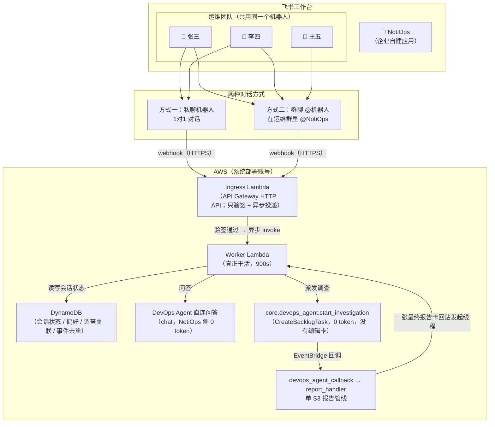
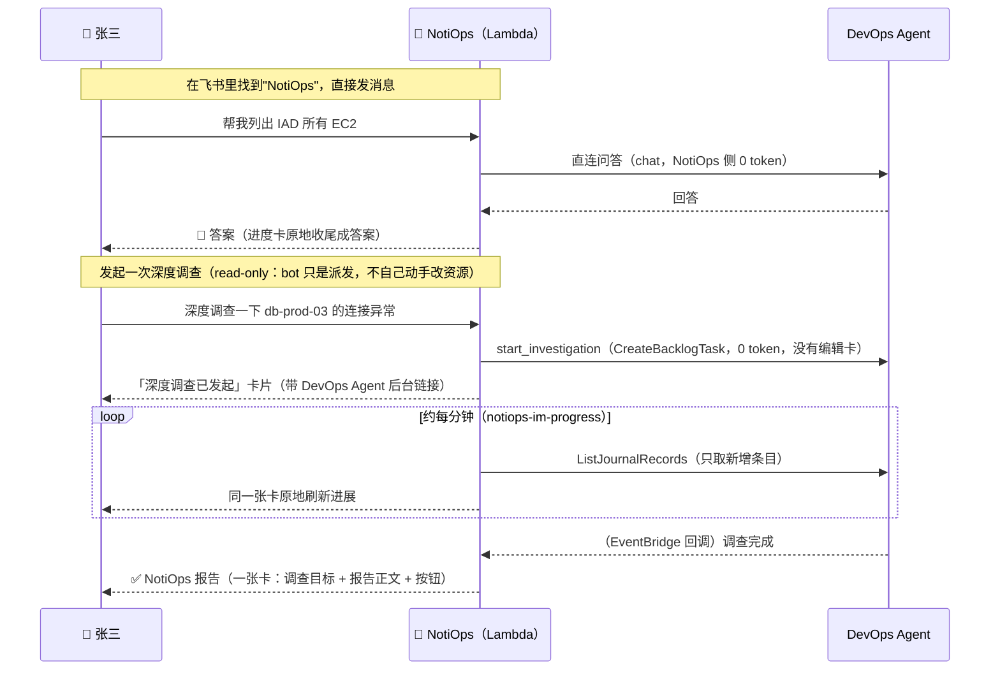
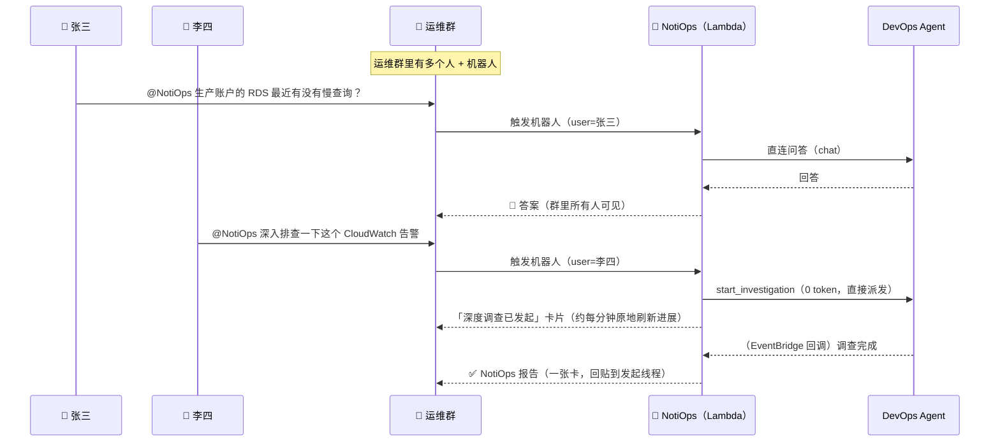
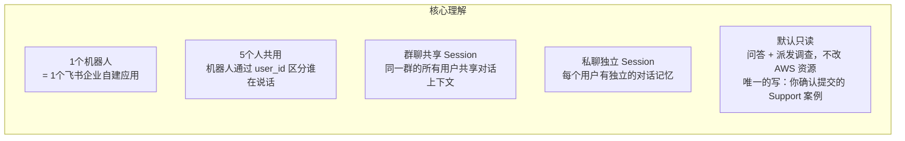
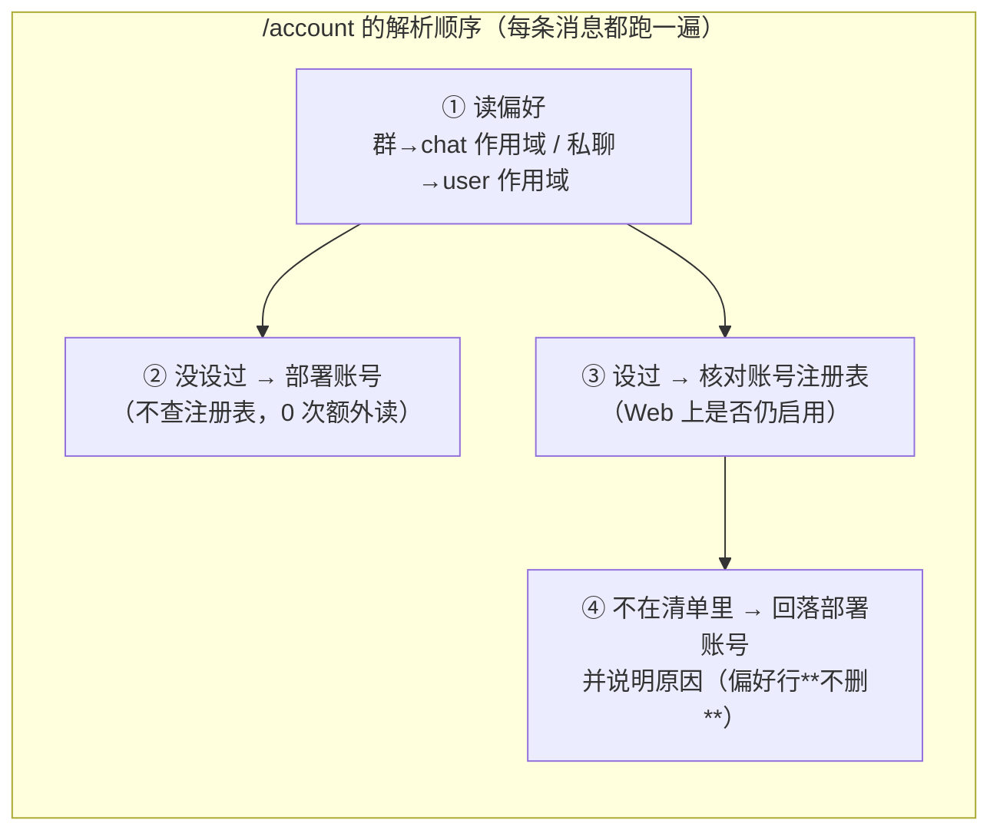
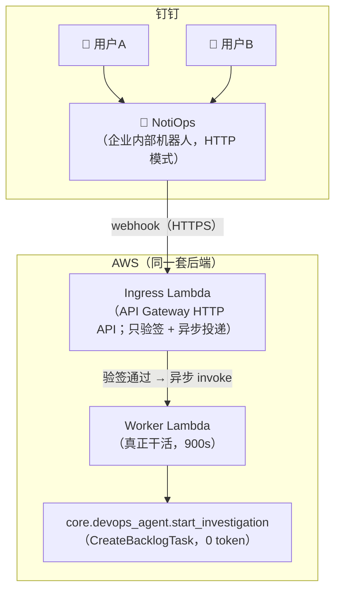
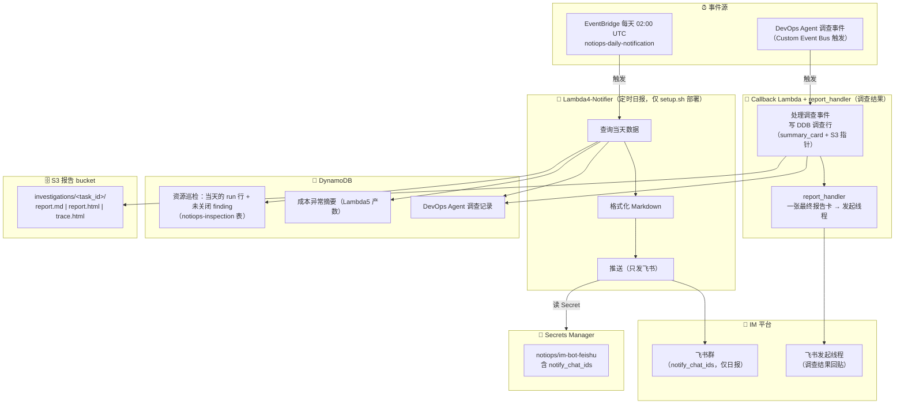

# IM 机器人交互方式说明

> ℹ️ **入口定位**:NotiOps 的**主入口是浏览器里的 Web Chat 网页控制台**(见 `USER_GUIDE.md` 第一部分);飞书 / Slack 等 IM 是必要但**次要的补充入口**。本文档只讲 **IM 补充入口**的交互方式与配置。

> ⚠️ **NotiOps bot 默认只读**:它做**问答**(默认把问题直接交给 DevOps Agent 作答)和**发起调查**(派发给 DevOps Agent),**不代用户改任何 AWS 资源**。唯一的写操作是 **Support 案例**的开 / 回复 / 关闭 —— 由你确认提交才执行,并要求目标账号的角色带 support 写权限(成员模板参数 `EnableSupportCaseWrite`,默认开,见下文「开案例也跟着 `/account` 走」那一条)。

## 飞书交互方式

只需要创建 1 个飞书企业自建应用（机器人），所有运维人员共用这一个机器人。

### 整体流程



### 方式一：私聊机器人



### 方式二：群聊 @机器人



### 关键点



### 偏好的作用范围：群 = 整群，私聊 = 每人（含 `/account` 问哪个账号）

三条开关命令（`/agent` 换 agent、`/web` 联网、`/account` 换问哪个账号）与 Session
**同一套作用范围**：**群里设一次对整群生效，私聊里只对你自己生效**。
存储都在 `core/im_prefs.py` 的同一张表、同一套 key（`impref#<feature>#<scope>#<平台>:<id>`），
30 天不用自动过期。



- **账号上车（新增 / 启用 / 停用）只在 Web 控制台**，IM 只**读**那份注册表
  （`shared/queries/accounts.py` 的 GSI1 Query，写入方只有 Web BFF 的
  `bff/web-chat/member_accounts.mjs`）。所以 Web 上一启用，IM **下一条消息**就能选到；
  Web 上一停用，IM 那侧的选择下一条消息就自动回落。
- **两侧各自选，互不影响** —— 共享的只有「哪些账号可选」这份清单。
- **开案例也跟着 `/account` 走**（2026-09-07 起，`caps.case` → `case_flow.start_*` →
  `core/support_logic.py` 全线透传 `account_id`，空串 = 部署账号）。跨账号凭证走
  `core/aws_session.py`：`role_arn` **只信 config 表那一行**、assume 前过
  `shared/account_scope.assert_role_belongs_to`、**拿不到就报错绝不回落到部署账号**。
  写操作要求目标账号的角色带 `support:CreateCase` / `AddCommunicationToCase` /
  `ResolveCase`（成员模板参数 `EnableSupportCaseWrite`，默认开）。
  卡片会写明工单开在哪个账号下（工单号跨账号可撞号，控制台链接不带账号参数）。
- **报告卡上的 🆘 升级开单 / 「📎 同步到 case」跟的是「这次调查查的那个账号」**，
  不是点按钮那一刻会话里选的账号 —— 卡可能几小时后才被点。账号来源按优先级：
  按钮 value 里的 `case_account_id`（发卡时盖的章）→ `support#<incident_id>` 行里的
  `account_id`（`report_handler._persist_support_context` 写的，也兜住改动前发出的旧卡）。
- 越权的拦截线**不在** IM 侧，而是随每一轮请求带给 agent 的账号闸门
  （`core/im_accounts.allowed_accounts()`：只含「部署账号 + 已启用账号」，
  **拿不到清单时返回拒绝用的哨兵值而不是放开**）。

## 钉钉交互方式

> ✅ **钉钉已上线（2026-09-08 起两条部署路径都开放）**：`./setup.sh` 里的选项 `3`、一键部署 `InstallOption=web+dingtalk`。钉钉与飞书 / Slack 是**同一个 Lambda webhook 形态**：自己的 API Gateway HTTP API + 一对 Lambda（`platforms/dingtalk/lambda_ingress.py` 验签去重 → `lambda_worker.py` 干活），CDK 输出 `DingtalkWebhookUrl`。对话 / 调查派发 / 报告回贴 / case 全流程都可用。**主动推送**里只有**巡检推送**会投钉钉，但这一版还配不起来：巡检只有 `setup.sh` 部署才有；发送地址是群里另加的自定义机器人地址（secret 里可选的 `webhook_url`，「集成 IM」钉钉分页上就能填），可巡检推送还要先把群登记成推送目标 —— 本版本**还没有**这一步的途径（没有网页入口、`setup.sh` 不问、发布包里也没有对应的工具）。每日通知、Health 和实时事件推送都不投钉钉，见下面的对比表。**ECS Fargate 长连接形态已于 2026-09-03 退役**，不再创建任何 ECS task。

钉钉的逻辑与飞书一致：创建 1 个钉钉企业内部机器人（**HTTP 模式**），所有人共用。



## 飞书 vs 钉钉 对比

| 项目 | 飞书 | 钉钉 |
|------|------|------|
| 机器人类型 | 企业自建应用 | 企业内部机器人 |
| 创建位置 | 飞书开放平台 | 钉钉开放平台 |
| 当前状态 | ✅ 已上线 | ✅ 已上线（2026-09-08 起两条部署路径都开放）|
| 连接方式 | API Gateway HTTP API + Lambda webhook（ingress 验签 + worker 干活）| 同上（同一个形态，各有一套自己的 API + 一对 Lambda）|
| 私聊 | ✅ 支持 | ✅ 支持 |
| 群聊 @ | ✅ 支持 | ✅ 支持 |
| 定时日报推送 | ✅ 支持（Lambda4，配置 `notify_chat_ids`；**只有 `setup.sh` 部署才有**）| ❌ 不支持（Lambda4 只发飞书）|
| 其他主动推送 | Health（PHD 转发，同样投 `notify_chat_ids`）+ 巡检推送；都**只有 `setup.sh` 部署才有**。巡检推送不读 `notify_chat_ids`，要先把群登记成推送目标，而本版本**还没有**这一步的途径（没有网页入口、`setup.sh` 不问、发布包里也没有对应的工具），所以这一版实际配不起来 | 只有巡检推送（`setup.sh` 部署才有）。发送走自定义机器人地址 `webhook_url`（「集成 IM」钉钉分页能填），但同样要先登记推送目标、同样**还没有**途径，所以同样配不起来；而且钉钉最多只能有一个推送目标（那个地址绑死一个群）|
| 调查结果返回 | ✅ 回贴发起线程（一张最终报告卡 summary_card + 「查看完整报告」）| ✅ markdown 回贴（会话内回复走入站报文自带的 `sessionWebhook`，报告回贴走服务端 API + 派发时存下的路由；投不出去才落到 `webhook_url` 兜底）|
| 进度反馈 / case 管理 | ✅ 原地刷新的卡（问答卡随输出刷新；深度调查卡约每分钟刷新一次）+ case 全流程 | ✅ case 全流程；问答的进度是**追加式**（消息不可编辑 → 作为新消息追加，一轮最多 2 条）；深度调查**不自动刷新**，回执里会明说，报告跑完自动投回会话 |
| 卡片按钮能否回传服务器 | ✅ 能（🆘 升级开单 / 📎 同步到 case 都是回传按钮）| ❌ **永久不能**（ActionCard 按钮只能跳 URL，没有按钮回调）→ 需要确认的动作（开案例 / 关案例）改成**回复关键词**完成（深度调查本来就是直接派发，不需要确认） |
| 后端 | 一对 Lambda（`setup.sh` 部署在 `ImStack` 里，一键部署在单栈里）+ `core.devops_agent.start_investigation`（CreateBacklogTask，0 token） | 共用同一套后端 |

> ⚠️ **CloudWatch Alarm / Backup / GuardDuty / Cost Anomaly / Trusted Advisor 这类实时事件推送，目前两家都收不到。**
> 推送 Lambda（`notiops-push-handler`）开不开只看它自己的环境变量（`PUSH_TARGET_PLATFORM` /
> `PUSH_TARGET_CHAT_ID`，钉钉还认 `DINGTALK_PUSH_WEBHOOK_URL`），**不读** `notify_chat_ids`，也不看钉钉
> secret 里的 `webhook_url`；而哪条部署路径都不设这些变量 —— 所以即使把 `notiops-push-*` 规则打开，
> 它也只记一行「Push disabled」就返回。这类事件请在 Web Chat 左侧「通知」里看（两条部署路径都有；
> 默认开 Health / CloudWatch Alarm / GuardDuty / Cost Anomaly / Trusted Advisor 五类，Backup 等默认关）。

## 总结

- 飞书 / Slack / 钉钉**三家同一个形态、都已上线**（钉钉 2026-09-08 起，两条部署路径都开放）
- 所有用户共用机器人，通过 user_id 区分身份
- bot 是每个平台 **两个 Lambda**（`setup.sh` 部署在 `ImStack` 里，一键部署在单栈里），外加一个各平台共用的进度轮询 Lambda：ingress 由 API Gateway HTTP API 触发收 webhook、**只验签 + 异步投递**（`reservedConcurrentExecutions=10`），worker 真正干活；默认只读：问答 + 派发调查，唯一的写是你确认提交的 Support 案例。原来的 ECS Fargate 长连接容器**已于 2026-09-03 退役、不再创建**（`infra/lib/bot-stack.ts` 与三个 Dockerfile 还留在仓库里作长连接回滚路径的存档，但不被任何 app 引用，所以也不再需要 Docker / finch 构建 IM 镜像）
- **调查派发链路**（webhook 现网路径）：明说要深挖（`/调查` —— 斜杠可省，消息第一个词是 `调查` / `排查` / `investigate` 这类命令词就算，见 `USER_GUIDE.md` §13.4；或「深度调查 / 根因分析」这类说法）→ `platforms/*/caps.py::investigate` → `core.devops_agent.start_investigation`（CreateBacklogTask，0 token，**没有编辑卡**）→ `ddb_state.link_im_investigation` 落 `incident#` + `task#` 两行 → 「深度调查已发起」卡由 `notiops-im-progress` 每分钟原地刷新 → EventBridge → `devops_agent_callback` → `report_handler` 单 S3 报告管线 → **一张最终报告卡回贴发起线程**（summary_card + 「📊 查看完整报告」按钮）。编辑卡 3 字段（`details / starting_point / log_snippet` → `core/dispatch_compose.compose_edited` → `create_investigation(incident_id=...)`，在 description 末尾嵌 `<!--notiops:<id>-->` 标记）只存在于已退役的长连接 app（`platforms/*/app/main.py`）里
- 报告单一 S3 来源：`investigations/<task_id>/report.md|report.html|trace.html`；DDB 调查行 = summary_card + S3 指针（**不再内联 summary_raw**）
- **调查事件不推送 `notify_chat_ids`**（`_notify_im` 已从 `devops_agent_callback/handler.py` 删除）；`notify_chat_ids` 只用于 Lambda4 每日 02:00 UTC 日报（+ PHD），这两样都**只在 `setup.sh` 部署里有**
- `setup.sh` 部署每天 02:00 UTC 往配置了 `notify_chat_ids` 的**飞书**群推一份「每日运维通知」（资源巡检 + 成本异常 + 过去 24h 调查）；一键部署没有这条，钉钉 / Slack 也收不到

## 飞书机器人配置步骤

飞书走 **API Gateway HTTP API + Lambda webhook**（`ImStack`），不再是长连接。完整的分步操作在
另外两篇里，这里只给顺序骨架，避免同一套步骤两处维护、走样：

| 阶段 | 干什么 | 在哪 |
|---|---|---|
| **部署前** | 建企业自建应用、开机器人能力、导入 11 条权限、拿 App ID / App Secret + Encrypt Key / Verification Token、发布版本 | [DEPLOYMENT.md](DEPLOYMENT.md) §3.1 |
| **部署** | `./setup.sh` 里选飞书 → 建出 `ImStack`，输出 `FeishuWebhookUrl` | [DEPLOYMENT.md](DEPLOYMENT.md) §5 |
| **部署后** | 把两把钥匙写进 Secret，再把 webhook 地址填进「事件配置」+「回调配置」两处 | [IM_WEBHOOK_SETUP.md](IM_WEBHOOK_SETUP.md) §1 |

⚠️ **顺序是硬的**：请求地址必须在「栈已部署」**且**「`encrypt_key` / `verification_token`
已写进 Secret」之后才填 —— 飞书保存地址时会立刻发一次校验请求，钥匙缺一个 ingress
就冷启动失败，控制台显示「校验失败」，看起来像地址填错了。

### 验证

在飞书中找到机器人，发送一条消息（如「帮我列出 IAD 所有 EC2」），如果收到回复则配置成功。
没回复时按 [IM_WEBHOOK_SETUP.md](IM_WEBHOOK_SETUP.md) §1.5 那张症状表定位（两个 Lambda
的日志分别说明是「没发过来」「验签没过」还是「投递失败」）。

## 钉钉机器人配置步骤

> 钉钉现在可用（`./setup.sh` 选项 `3` / 一键部署 `web+dingtalk`）。完整的分步操作在
> [IM_WEBHOOK_SETUP.md](IM_WEBHOOK_SETUP.md) §3，这里只给顺序骨架。

1. 在 [钉钉开放平台](https://open-dev.dingtalk.com) 创建企业内部应用，获取 **AppKey** / **AppSecret**
2. 「应用能力 → 机器人」→ 启用 → 消息接收模式选 **HTTP 模式**，消息接收地址填 CDK 输出的 `DingtalkWebhookUrl`
   （钉钉只有这一处要填：消息事件和卡片回传走同一条 URL）
   > ⚠️ **默认值是 Stream 模式，必须手动改掉。** 留在 Stream 模式 = 钉钉永远不 POST =
   > 机器人一句话不回；而钉钉保存回调地址时**不做任何校验**（没有飞书那种当场校验），
   > 控制台上看不出任何异常。排错只能看 `/aws/lambda/notiops-im-ingress-dingtalk` 与
   > `/aws/lambda/notiops-im-worker-dingtalk` 两条日志。
3. 凭证填进 Secret `notiops/im-bot-dingtalk` —— **推荐**在 Web Chat 左侧「更多 → 管理」→「集成 IM」→ 钉钉分页填（`setup.sh` 部署时这个 Secret 由 CDK 建成空的；一键部署的模板不建它，第一次在网页上保存时由后端创建），JSON 字段：
   - `app_key` / `app_secret` → **必填**，ingress 冷启动硬校验，缺一个入口就直接起不来
   - `webhook_url` → **可选**，群里另加的自定义机器人的地址（网页上叫「自定义机器人推送地址」，就在这一页填），只有两处会用：**巡检推送**（只有 `setup.sh` 部署才有；而且光有地址不够，还要先把群登记成推送目标 —— 本版本**还没有**这一步的途径：没有网页入口、`setup.sh` 不问、发布包里也没有对应的工具，所以这一版其实配不起来）和**报告回写的兜底**（按会话投递失败时才落到这个地址）。定时日报、Health 和实时事件推送都不投钉钉，填了它也收不到
4. 权限：**不用**像飞书那样逐条勾 —— 机器人收发消息走机器人能力自带的通道
5. 到「版本管理与发布」发布一个版本，并把机器人加进目标群

## 定时日报推送（主动通知）

除了用户主动发消息给机器人（被动响应），系统还有一种主动通知：**Lambda4 每日运维通知** —— 每天 UTC 02:00（北京时间 10:00）推一条到配置了 `notify_chat_ids` 的**飞书**群，汇总资源巡检（高负载 / 闲置两类当天跑没跑、当前还有多少未关闭的风险）、成本异常和过去 24h 内发起、已结束的调查。两类巡检默认也是 02:00 UTC 跑，不改定时的话当天那一轮赶不上这份日报，见下面「执行时序」。

> ⚠️ **只有 `setup.sh` 部署才有，而且只发飞书。** 一键部署（方式 A）不含 Lambda4、PHD 转发和资源巡检，那里「推送群组 Chat ID」填了也收不到日报；钉钉 / Slack 在两条部署路径上都收不到它。

> ℹ️ **调查事件不在这里推送**。DevOps Agent 调查任务的结果通过 `report_handler` **回贴到发起调查的对话线程**（一张最终报告卡），**不会**广播到 `notify_chat_ids`。`_notify_im` 已从 `devops_agent_callback/handler.py` 删除；`notify_chat_ids` 现在只服务 Lambda4 日报（+ PHD）。

### 架构



### 执行时序（定时日报）

| 时间 (UTC) | 事件 | 说明 |
|------------|------|------|
| 每 15 分钟 | 资源巡检调度器（`notiops-inspection-scheduler`） | 判定这一轮该跑哪些「类型 × 账号」的巡检（高负载 / 闲置两类）。执行时刻按类型配置，**两类默认都是 02:00 UTC**；存 DDB，在 Web Chat 左侧「更多 → 巡检」→「配置 → 阈值与定时」里改，不用重新部署 |
| 01:15 | Lambda5-CostAnalyzer | 成本异常分析 |
| 02:00 | Lambda4-Notifier | 读当天的巡检与成本异常 + 过去 24h 内发起、已结束的调查 → 推送日报到飞书 `notify_chat_ids` |

> ⚠️ Lambda4 只看**当天（UTC）**的巡检 run 行，而两类巡检**默认和日报同在 02:00**：调度器 15 分钟一跳，02:00 那一档要到 02:00–02:15 之间才派出去，日报那一刻它要么还没开始、要么刚起跑。所以某一类的执行时刻在 02:00 或更晚的话（不改定时就是这样），当天日报里那一类只会是「今日未跑」或刚起跑的「⏳ running（发现 ?）」—— 意思是「还没跑完」，不是「没风险」；「当前未关闭风险」那一行照常列出（之前几轮留下的）。想让当天的结果进日报，到 Web Chat 左侧「更多 → 巡检」→「配置 → 阈值与定时」把「执行时刻 (UTC)」提前到 02:00 之前，并留够跑完的时间。

### 调查结果返回（Callback Lambda + report_handler）

DevOps Agent 调查任务状态变更时，通过 EventBridge 跨账户转发到系统账号 Custom Event Bus，Callback Lambda 消费事件：

| Detail-Type | 处理 |
|-------------|------|
| `Investigation Created` | 🔵 新调查已创建（发起线程进度卡）|
| `Investigation Completed` | ✅ 拉报告 → 写 S3（report.md/html）+ DDB 调查行（summary_card + S3 指针）→ 一张最终报告卡回贴发起线程 |
| `Investigation Failed` | ❌ 不拉报告、不写 S3，以失败描述入库 + 失败卡 |
| `Investigation Timed Out` | ⏰ 同失败路径 |
| `Investigation Cancelled` | ⏹ 调查已取消 |
| `Investigation Linked` | 🔗 已关联到其他调查 |

> `report_handler` 通过从 journal 反向 grep `<!--notiops:<id>-->` 标记（双兼容正则同时识别旧的 `<!--notiops-devops:<id>-->`）拿到 incident_id，查 DDB `incident#` row 拿到 chat 上下文，把最终报告卡精准回贴到发起调查的那个线程。

> ⚠️ **从 IM 里发起的调查靠的是另一把键（`task#`）**。Webhook 路径（`platforms/*/caps.py::investigate`）
> 不写 journal 标记 —— `core.devops_agent.start_investigation()` 没有 `incident_id` 参数，
> 我们合成的 `feishu-<event_id>` / `slack-<event_id>` 到不了回调侧（现网日志里 `incident_id=`
> 就是空的）。所以发起时用 `ddb_state.link_im_investigation()` **同时**落 `incident#` 与
> `task#<task_id>` 两行，`_resolve_chat_target()` 靠后者命中。
>
> 这里有**两条互不相干的链路**，改一条不会自动修好另一条：
>
> | 链路 | 认的键 | 谁在刷 |
> |---|---|---|
> | 每分钟的**进度卡** | `imtask#<incident_id>` | EventBridge `rate(1 minute)` → `notiops-im-progress` |
> | 跑完那张**最终报告卡** | `incident#<id>` / `task#<task_id>` | DevOps Agent EventBridge → `notiops-devops-callback` → `report_handler` |
>
> 少了 `task#` 那一行的症状很难查：进度卡一路刷到「已完成」，报告安静地躺在 S3 里，
> **一个错都不报**（2026-09-02 现网实测形态）。报告链接是 **presigned S3 URL**，
> 不是 CloudFront —— web 端的 `save_report` 才走 CDN，这是两条不同的链路。
> ⚠️ 这条链接**活不过 7 天**：`ExpiresIn` 虽然是 7 天（`PRESIGN_EXPIRY` 默认 604800），
> 但签名用的是 callback Lambda 的临时凭证，凭证一过期链接就失效 —— 最长约 12 小时
> （卡片落款写的就是「链接数小时内有效（最长约 12 小时）」）。对象本身留在
> `investigations/<task_id>/` 下，这个前缀**没有**生命周期规则，跟着数据桶一起删。

### 通知内容（日报）

标题是「📋 **<日期> 每日运维通知**」，正文三段（2026-09-04 起巡检段改读新巡检系统，老 idle-detector 的 RDS / ElastiCache 健康报告与闲置分析已退役）：

1. **🔍 资源巡检** — 逐账号写两类巡检（高负载 / 闲置）**今天跑没跑**、跑了发现几条，再加当前未关闭风险的严重度分布和其中「判读已回」几条。「今日未跑」「数据暂不可用」与「跑了、发现 0」三种写法**互不混用**（没跑 ≠ 没风险）
2. **🔥 成本异常检测** — 异常总数、预计 7 天额外成本 + 按账号的明细（评分 ≥ 60 的才列）；没有异常时只有一行「✅ 成本异常：全部账号过去 24h 无成本异常」
3. **📋 昨日调查汇总（过去 24h）** — 过去 24h 内**发起**、且已结束（完成 / 失败 / 超时）的调查，一条一行（按发起时间筛，行里的时间也是发起时间；更早发起、最近才结束的不会出现）；没有就不出这一段

末尾一行指路：带上 Web Chat 地址，提示去左侧「更多 → 巡检」看板看判读详情与处置入口。这个地址是 `setup.sh` **重跑**时从已部署的 Web Chat 读回来的；首装那一轮还读不到，那一行就只写「见 Web Chat 巡检看板」。

**跳过规则**：今天两类巡检都没跑、没有未关闭的风险、没有成本异常、过去 24h 内发起的调查也没有一条已结束 —— 四样全空才跳过。巡检或成本数据**读失败**不算「没东西」：照发，那一段标成 ⚠️ 数据暂不可用。

### 配置方法（推荐走 Web Chat「集成 IM」页）

**推荐**：Web Chat 左侧「更多 → 管理」→「集成 IM」→ **飞书 / Lark** 分页（「管理」仅 admin 可见）：
- 填入飞书凭证（App ID / App Secret / Encrypt Key / Verification Token）+「推送群组 Chat ID」（即 `notify_chat_ids`，可加多个群）
- 后端通过 `PUT /admin/notification-config` 写回 `notiops/im-bot-feishu` Secret，带格式校验（`cli_xxx` / `oc_xxx`）；Secret 不存在时由后端创建
- 敏感字段（secret / token）在页面上只显示后 4 位（`****xxxx`）；原样保存 = 不修改，所以只改推送群时不用重填钥匙
- 每个群 ID 旁的「测试」走 `POST /admin/notification-config/test`，往那个群真发一条测试消息验证配置
- 这一页**飞书 / 钉钉 / Slack 都能配**（顶部切平台分页；同一组 `/admin/notification-config` 路由，GET 一次拿回全部平台，PUT / test 按 `platform` 分发）。钉钉分页填 AppKey / AppSecret + 可选的「自定义机器人推送地址」（钉钉收不到日报，这个地址只给巡检推送和报告回写兜底用），见 [IM_WEBHOOK_SETUP.md](IM_WEBHOOK_SETUP.md) §3.3 / §3.7；Slack 分页只收 Bot User OAuth Token + Signing Secret（**没有**推送群这一项），见 [IM_WEBHOOK_SETUP.md](IM_WEBHOOK_SETUP.md) §2.2

> ℹ️ 老 Dashboard 的「设置 → 通知设置」页（`/settings/notifications`）和它背后的 `/api/notification-config` 已于 2026-09-04 随老控制台一起退役，上面这一页就是它的接替（路由清单见 [api-reference.md](api-reference.md) §1.7 / §6）。

**或直接改 Secret JSON**（绕过校验，仅建议运维排障时使用）：

飞书（`notiops/im-bot-feishu`）：

```json
{
  "app_id": "cli_xxxxxxxx",
  "app_secret": "xxxxxxxx",
  "verification_token": "xxxxxxxx",
  "encrypt_key": "xxxxxxxx",
  "notify_chat_ids": "oc_xxx,oc_yyy"
}
```

- ⚠️ **`verification_token` 和 `encrypt_key` 两个都必填**（webhook 模式下它们是唯一的请求鉴权手段）。改这个 JSON 时务必**先读出现有值再整体写回**，否则会把另外几个字段抹掉；缺任一把钥匙，ingress Lambda 会在冷启动时直接失败，飞书控制台表现为「校验失败」。取值与自检见 [IM_WEBHOOK_SETUP.md](IM_WEBHOOK_SETUP.md) §1.2
- `notify_chat_ids`：逗号分隔的群 ID 列表
- 飞书群 ID 格式：`oc_xxxxxxxx`（在飞书群设置中查看）
- 不填或留空则**日报跳过**，PHD 转发也不发（调查结果仍照常回贴到发起线程，不依赖 `notify_chat_ids`）

### 通知示例

> 这个示例假设两类巡检的执行时刻都已提前到 02:00 之前：111122223333 两类都已跑完，444455556666 的高负载那一轮到 02:00 还没跑完。按默认的 02:00，两个账号的两类都只会是「今日未跑」或「⏳ running（发现 ?）」（见上面「执行时序」下的说明）。

```markdown
📋 **2026-03-20 每日运维通知**

**🔍 资源巡检**

- [111122223333] 高负载：✅ success（发现 2） ｜ 闲置：✅ success（发现 5）
  当前未关闭风险 **7**：🟠2 🔵5 ｜ 判读已回 2
- [444455556666] 高负载：⏳ running（发现 ?） ｜ 闲置：✅ success（发现 0）

**🔥 成本异常检测**

- 异常总数: **1** 个
- 预计 7 天额外成本: **$312.20**

**异常明细（按账号）：**

- [111122223333] **Amazon Elastic Compute Cloud - Compute** | 评分 84 | High | 🔴 高优先 | 基线 $40.00/天 → 近3天 $84.60/天 | 预计7天额外 $312.20 ─↑─↑↑↑

**📋 昨日调查汇总（过去 24h）**

- [账号 111122223333] RDS 连接数突增 — 2026-03-19T08:12:03.512844Z (task_id: `3f2a9c1e-…`) ✅

---
💡 判读详情与处置入口：https://<你的 Web Chat 地址>（左侧「更多 → 巡检」看板）
```
